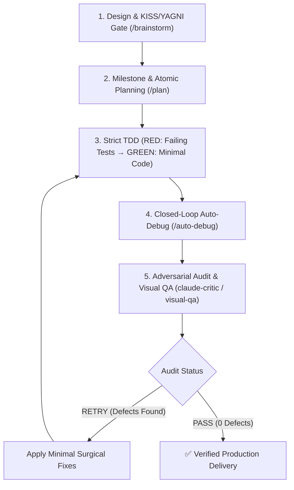

# 🚀 Antigravity Dev Suite (Claude Opus 5.5 + ASD-STE100 v1.23.0)

**Enterprise-Grade, 100% Cross-Platform Development & Cognitive Reasoning Suite for Google Antigravity (AGY)**.  
Combines the best engineering patterns from **`mega-mind`**, **`ECC (Everything Claude Code)`**, **`superpowers`**, the **Claude Opus 5.5 Standard**, and **ASD-STE100 (Simplified Technical English)**. Calibrated for maximum efficiency with **Gemini Flash 3.8 and model inheritance** across **macOS (Intel & Apple Silicon), Linux, and Windows 10/11**.

---

## 📐 ASD-STE100 Technical Communication Standard
The suite strictly enforces ASD-STE100 across all agent interactions, diagnostic reports, and code comments:
- **Active Voice & Imperative Mood**: Direct procedural instructions (`Execute test suite`, `Validate inputs`).
- **Controlled Sentence Length**: Maximum 20 words per procedural instruction, maximum 25 words per descriptive sentence.
- **Unambiguous Terminology**: One word = one meaning; zero conversational filler, jargon, or pleasantries.
- **Deterministic Tables & Schemas**: Dense tabular outputs, atomic tasks, and clickable markdown links.

---

## ⚡ Complete Slash Commands Matrix

Every skill in the suite is exposed as a first-class native slash command in Antigravity:

| Slash Command | Skill Module | Cognitive Phase | Key Capabilities |
| :--- | :--- | :--- | :--- |
| **`/opus-dev`** | `skills/opus-dev` | **Autonomous Meta-Engine** | Autonomous closed-loop engineering (*Design & Invariants $\to$ Plan $\to$ TDD & Properties $\to$ Auto-Debug & Benchmark $\to$ Adversarial Critic Loop until `PASS`*). |
| **`/brainstorm`**| `skills/brainstorm`| **Ideation & Architecture** | Explores **2-3 architectural approaches**, evaluates KISS/YAGNI trade-off matrix, defines algorithmic bounds ($O(n)$) and formal inductive invariants ($P, I, V, Q$). |
| **`/plan`** | `skills/plan` | **Milestone Decomposition** | Breaks down tasks into atomic Red-Green steps with explicit TDD targets, typestate transitions, and formal inductive invariants. |
| **`/auto-debug`**| `skills/auto-debug` | **Closed-Loop Auto-Fix** | Auto-detects 10+ test, coverage & mutation frameworks, parses stacktraces at AST level, auto-fixes up to 3 cycles. |
| **`/code-review`**|`skills/code-review`| **Adversarial Audit** | **5-Pass Inspection**: Invariants & Bounds, Concurrency & Leaks, OWASP Top 10 Security, Typestate & Strict Types, Property Fuzzing & Mutation Gate. |
| **`/commit`** | `skills/commit` | **Pre-Commit Verification** | 4-Phase pre-commit pipeline executing secret scans, static audits, test validation, and Conventional Commits formatting. |
| **`/benchmark`** | `skills/benchmark` | **Performance & Hotspots** | 4-Phase microbenchmark & profiling harness (Ecosystem detection, Hotspots $O(n^2)$, Memory leaks, >5% regression threshold). |
| **`/refactor`** | `skills/refactor` | **Tech Debt Remediation** | Safe refactoring & KISS simplification with baseline verification, preserving 100% green tests and public APIs. |
| **`/visual-qa`** | `skills/visual-qa` | **Multimodal UI Inspector** | Dual-viewport Playwright screenshots (**Desktop 1280x800 + Mobile 375x667 iPhone SE**). |
| **`/security-audit`** | `skills/security-audit` | **Vulnerability Harness** | Cloudflare 4-phase audit (Recon, Coverage Sweeps, Hunter/Verifier, Supply Chain CVEs, `findings.json` & `SECURITY-REPORT.md`). |
| **`/handoff`** | `skills/handoff` | **Session Context Preservation** | Exports portable Markdown briefing to temp directory with telemetry (`PASS`), git state, secret scrubbing, and next skill pointers. |

---

## 🔄 Autonomous Closed-Loop Verification Pipeline (`/opus-dev`)



---

## 🤖 Specialized Subagent Personas

All subagents configure `model: inherit` to preserve parent execution speed and eliminate model initialization delays:

| Subagent | Persona File | Model | Role & Expertise |
| :--- | :--- | :--- | :--- |
| **`opus-architect`** | `agents/opus-architect.md` | `inherit` | System design, design pattern selection, complexity analysis ($O(n)$), KISS/YAGNI anti-overengineering gate, and API stability. |
| **`claude-critic`** | `agents/claude-critic.md` | `inherit` | Strict 7-pillar adversarial inspector for negative constraints, KISS/YAGNI compliance, concurrency, edge cases, and OWASP Top 10 vulnerabilities. |
| **`visual-qa-critic`**| `agents/visual-qa-critic.md`| `inherit` | Multimodal UI/UX and accessibility critic inspecting mobile horizontal overflow, tap targets (≥44px), and console errors. |

---

## ⚡ Gemini Flash 3.8 Acceleration & Caching Architecture

The suite implements local deterministic caching and token hygiene to maximize Gemini Flash 3.8 performance without latency bottlenecks:
- **Persistent `mtime` Disk Cache (`scripts/repo_map.py`)**: Stores file symbol maps at `.gemini/cache/repo_map_cache.json`. Incremental scanning skips unchanged files and provides sub-5ms symbol resolution.
- **AST Semantic Slicing (`scripts/semantic_slice.py`)**: Extracts only targeted functions or classes, avoiding multi-hundred-line file reads and context dilution.
- **Stream Output Condensation (`scripts/auto_debug_runner.py`)**: Filters noisy framework frames and caps failure assertion diffs to $\le 30$ lines.
- **Spec-First Formal Invariant Matrices**: Mandates pre-conditions, post-conditions, and invariant contracts prior to writing code, enabling first-pass correctness.
- **Zero-Pro Subagent Inheritance**: Enforces `model: inherit` on all subagents to eliminate heavy model switching delays.

---

## 🌐 100% Cross-Platform Native Architecture

The suite operates across all major operating systems without native compilation dependencies:

| Operating System | Architecture / Shell | Linking Mechanism | Permissions & Requirements |
| :--- | :--- | :--- | :--- |
| **🍎 macOS** | Intel x86_64, Apple Silicon (M1/M2/M3/M4) / `zsh`, `bash` | POSIX Symbolic Link (`ln -sf`) | Python 3.10+, User permissions |
| **🐧 Linux** | Debian, Ubuntu, RHEL, Fedora, Arch, Alpine / `bash` | POSIX Symbolic Link (`ln -sf`) | Python 3.10+, User permissions |
| **🪟 Windows 10/11** | x86_64, ARM64 / PowerShell 5.1 & PowerShell Core 7+ | Native NTFS Directory Junction | Python 3.10+, **No Administrator required** |

- **Pure Python Standard Library**: Core runtime scripts ([`validator_core.py`](scripts/validator_core.py), [`critic_loop.py`](scripts/critic_loop.py), [`semantic_slice.py`](scripts/semantic_slice.py), [`api_contract_guard.py`](scripts/api_contract_guard.py)) use only Python built-in modules (`ast`, `re`, `json`, `pathlib`).
- **Zero Windows Developer Mode Requirement**: Windows uses native NTFS Directory Junctions (`New-Item -ItemType Junction`) avoiding Developer Mode or elevated Administrator prompts.
- **Resilient Fallback Design**: Playwright is used for visual QA; when unavailable, all linting, TDD, auto-debug, and code review capabilities remain 100% operational.

---

## 📁 Directory Structure

```text
antigravity-dev-suite/
├── plugin.json                 # Standard AGY plugin manifest (v1.23.0)
├── mcp_config.json             # Root Playwright MCP server definition
├── agents/                     # Subagent personas (Native Markdown, model: inherit)
│   ├── opus-architect.md       # System design, ADR persistence & scalability architect
│   ├── claude-critic.md        # Adversarial logic, migration & constraints critic (Opus 5.5 Standard)
│   └── visual-qa-critic.md     # Multimodal visual QA critic (Dual-Viewport)
├── rules/                      # System rules injected into context
│   ├── AGENTS.md               # Rulebook: enforced verification rules (section 0) + 16 guidelines
│   ├── database/               # Database migration and zero-downtime evolution rules
│   └── languages/              # Multi-language strict type-safety & idiomatic guidelines
├── skills/                     # Skill modules & First-Class Slash Commands
│   ├── opus-dev/SKILL.md       # /opus-dev: Unified autonomous engineering meta-engine
│   ├── brainstorm/SKILL.md     # /brainstorm: Architectural trade-off analysis & ADR persistence
│   ├── plan/SKILL.md           # /plan: Atomic milestone & TDD planning with Formal Invariant Matrix
│   ├── auto-debug/SKILL.md     # /auto-debug: Multi-ecosystem closed-loop auto-debugger (Tests, Types, Race, Fuzz)
│   ├── code-review/            # /code-review: 5-Pass adversarial security, invariants & typing gate
│   │   ├── SKILL.md            # Multi-pass code review workflow
│   │   └── references/         # Modular pattern reference catalog
│   ├── commit/SKILL.md         # /commit: Pre-commit verification pipeline & Conventional Commits
│   ├── benchmark/SKILL.md      # /benchmark: Microbenchmark & latency profiling harness
│   ├── refactor/SKILL.md       # /refactor: Safe tech debt remediation with invariants
│   ├── visual-qa/SKILL.md      # /visual-qa: Dual-viewport Playwright visual QA skill
│   ├── security-audit/         # /security-audit: Cloudflare-inspired vulnerability harness
│   └── handoff/SKILL.md        # /handoff: Cross-platform session handoff briefing generator
├── scripts/                    # Runtime runner scripts (Pure Python / Cross-Platform)
│   ├── validator_core.py       # Core AST, regex, JSONC, polyglot raw strings, and delimiter parser
│   ├── auto_debug_runner.py    # PostToolUse processor, tests, typecheck, race, fuzz, flaky runner & stream filter
│   ├── semantic_slice.py       # AST & brace symbol slicer for Flash 3.8 context hygiene
│   ├── api_contract_guard.py   # Automated public API contract drift detector (Python, TS, Go, Rust)
│   ├── repo_map.py             # Token-budgeted repository symbol mapper with persistent mtime cache
│   ├── handoff.py              # Standalone session handoff generator with secret redaction
│   ├── agy_hook.py             # Single entry point for all hooks + verification gate (check, doctor, stats)
│   ├── guidance.py             # Guided start: repo map, acceptance criteria, language rules on demand
│   ├── second_opinion.py       # Optional diff review by a stronger model (Anthropic or Gemini API)
│   ├── ui_flows.py             # UI flows: user journeys agy writes, run in Chromium by the gate
│   ├── integrity.py            # Diff integrity: placeholders, disabled tests, debugger, invented imports
│   ├── gate_stats.py           # Stop gate verdict log and statistics
│   ├── setup_hooks.py          # Registers hooks in ~/.gemini/config/hooks.json (install/update/uninstall)
│   ├── stop_gate.py            # Compatibility wrapper around the agy_hook.py Stop gate
│   ├── diff_guard.py           # AST diff hygiene & cognitive complexity analyzer
│   ├── symbol_impact.py        # Polyglot symbol dependency and blast radius tracer
│   ├── test_scaffolder.py      # Automated boundary and edge-case test scaffolder
│   ├── install_git_hooks.py    # Native cross-platform pre-commit Git hook installer
│   ├── pre_tool_guard.py       # PreToolUse safety guardrail (Blocks catastrophic commands & leaks)
│   ├── critic_loop.py          # Critic loop orchestrator CLI (Opus 5.5 Standard)
│   ├── discipline.py           # Stop gate discipline: tests fail on base commit, changed-line lint and coverage, API & diff review
│   ├── base_worktree.py        # Temporary checkout of the base commit (node_modules/venv linked)
│   ├── visual_gate.py          # Stop gate visual step: dev server, page selection, blocking report
│   └── visual_qa.py            # Playwright dual-viewport screenshot engine with WCAG 2.1 AA a11y audit
├── tests/                      # Automated Verification & TDD Suite
│   └── test_plugin_suite.py    # Full unit and integration test suite (400+ automated checks)
├── templates/                  # Zero-setup per-repository template
│   └── project-git-template/   # .agents/ & GEMINI.md template for team sharing
├── install.sh                  # 1-Click installer for macOS & Linux
├── install.ps1                 # 1-Click installer for Windows (PowerShell)
├── uninstall.sh                # Clean uninstaller for macOS & Linux
├── uninstall.ps1               # Clean uninstaller for Windows (PowerShell)
├── update.sh                   # git pull + re-register hooks (macOS & Linux)
└── update.ps1                  # git pull + re-register hooks (Windows)
```

---

## 📦 1-Click Installation

### 🍎 macOS & 🐧 Linux
```bash
# Clone repository
git clone https://ghb.internal.unicreditgroup.eu/scm/~c332376/antigravity-dev-suite.git
cd antigravity-dev-suite

# Run 1-Click installer
chmod +x install.sh
./install.sh

# Chromium (~150MB) is installed for the visual QA gate. To skip it:
./install.sh --no-browsers
# or AGY_INSTALL_BROWSERS=0 ./install.sh
```

### 🪟 Windows (PowerShell 5.1 / 7+)
```powershell
# Clone repository
git clone https://ghb.internal.unicreditgroup.eu/scm/~c332376/antigravity-dev-suite.git
cd antigravity-dev-suite

# Run 1-Click installer (Bypass only affects this run, if scripts are blocked)
powershell -ExecutionPolicy Bypass -File .\install.ps1

# Chromium is installed for the visual QA gate. To skip it:
powershell -ExecutionPolicy Bypass -File .\install.ps1 -NoBrowsers
```

### 🤖 Claude Code (Global Installation)
```bash
# In Claude Code 2.1.275+:
/plugin install antigravity-dev-suite --marketplace pubule/antigravity-dev-suite

# Or via CLI:
claude plugin marketplace add pubule/antigravity-dev-suite
claude plugin install antigravity-dev-suite --scope user
```

Requirements: Python 3.9+ (the macOS system `python3` works) and git. The installer:
1. links the suite into `~/.gemini/config/plugins/antigravity-dev-suite`;
2. registers the hooks in `~/.gemini/config/hooks.json` (read by both the Antigravity IDE and CLI), with the absolute path of your Python, so `python3` vs `py` and shell differences do not matter;
3. runs `agy_hook.py doctor`, which sends real-format payloads through every hook and fails the install if a check does not fire.

Check the result in the Antigravity CLI with `/hooks`, or any time with:
```bash
python3 scripts/agy_hook.py doctor        # Windows: py -3 scripts\agy_hook.py doctor
python3 scripts/setup_hooks.py status
```

---

## 🔄 Updating to Latest Version

Run the updater from the suite folder. It pulls the latest commits and registers the hooks again (needed when Python moves, for example after a Homebrew upgrade).

```bash
./update.sh                                # macOS & Linux
```
```powershell
powershell -ExecutionPolicy Bypass -File .\update.ps1   # Windows
```

## 🗑️ Uninstall
`./uninstall.sh` or `.\uninstall.ps1` removes the plugin link and only the suite's entry in `hooks.json`; your other hooks stay.

---

## 🛡️ Verification Gate (how agy is forced to check its work)

| Hook | When | What it does |
|---|---|---|
| `SessionStart` | new conversation | remembers the starting commit, so committed changes are still checked |
| `PreToolUse` | before `run_command` and file writes | blocks catastrophic commands, secrets, gate bypasses (`--no-verify`, `AGY_*` flags, state files, `.agents/agy.json`), edits whose new content has placeholder comments instead of code (`// ... existing code ...`), and edits to files agy has not opened in this conversation |
| `PostToolUse` | after file writes, `run_command` and read tools (`view_file`, `grep_search`, ...) | syntax probe of the written file; records which files agy has seen |
| `PreInvocation` | before each model call | first call: repository map and the request for acceptance criteria (guided start); each language's rules the first time a file of that language changes; open syntax errors |
| `Stop` | when agy wants to finish | runs syntax, static critic, diff integrity, test-first, typecheck/lint, tests (changed and related ones first, then the suite with coverage when available), the build, acceptance criteria and, for UI changes, visual QA and UI flows on all changed files; blocks with the full report until they pass. Then asks for one review turn when needed (see below), optionally after a second opinion from a stronger model |

The gate runs the checks itself; it never trusts a "PASS" written by the agent. Run it by hand with `python3 scripts/agy_hook.py check [project]`. The pre-commit hook (`install_git_hooks.py`) runs the same gate without the browser step (`check --no-visual`).

### Discipline checks
These make a fast model work like a careful one.

| Check | Kind | What it does |
|---|---|---|
| **Read before write** | block (PreToolUse) | An edit to an existing file that agy has not opened (or seen in a tool result) in this conversation is refused. It fails open: nothing is refused until a read tool has reached the hook once. Off: `"read_before_write": false` or `AGY_READ_BEFORE_WRITE=0`. |
| **Lint on changed lines** | failure | Without `lint_command`, the gate runs ESLint (when installed in `node_modules` with a config) and Ruff (when the project has a Ruff config) on the changed files, and keeps only findings on lines the change touched. Legacy warnings never block. Off: `"lint_changed_lines": false`. |
| **Tests must fail without the change** | review | The changed tests run on the base commit (temporary worktree, scoped to those files for pytest, Jest, Vitest and npm test). If they pass there too, they prove nothing: agy must make them check the changed behaviour, or say it is a pure refactor. Off: `"prove_tests": false`. |
| **Public API changed** | review | Exported symbols removed or with changed signatures (`api_contract_guard.py`). agy must check every caller. Off: `"api_guard": false`. |
| **Deleted comments or large blocks** | review | Comment and docstring stripping, large deletions, nesting blow-ups (`diff_guard.py`). Off: `"diff_guard": false`. |
| **Changed lines no test runs** | review | The test run is instrumented when the runner supports it (pytest with pytest-cov, Vitest with a coverage provider, Jest, `npm test` running either). Changed production lines that no test executed are listed. Without the plugin, the plain test command runs and the gate adds a note. Off: `"coverage": false` or `AGY_COVERAGE=0` (also off with the test-first rule). |
| **Acceptance criteria** | failure / review | At the start agy writes `.agy/criteria.md` (3 to 5 checkable behaviours). At Stop, an unticked criterion fails; a missing file, a file older than the conversation or a criterion ticked without evidence gets a review. `.agy/` is added to `.git/info/exclude`. Off: `"criteria": false` or `AGY_CRITERIA=0`. |
| **Loop breaker** | report | The same failure twice in a row (numbers ignored) adds a debug protocol: reproduce, read the code path, test hypotheses before editing. At the 4th time (`AGY_LOOP_ESCALATE`) agy must stop and explain to you what fails, what it tried and what it needs; the next stop is allowed. |
| **Targeted tests first** | failure | When the change has test files, or tests named after the changed files (`test_x.py`, `x.test.ts`, `x_test.go`), the gate runs only those first (pytest, Jest, Vitest, `npm test`). If they fail, it reports them at once and skips the full suite until they pass. Off: `"targeted_tests": false`. |
| **Build** | failure | `build_command`, or, when JS/TS/UI files changed and `node_modules` exists, the project's own `build` script (`npm`, `pnpm`, `yarn` or `bun` from the lock file). Runs only after all other hard checks pass. It catches bundler, SSR and import errors that tests and `tsc` miss. Off: `"build_command": false` or `AGY_BUILD=0`; timeout `build_timeout`. Not run by the pre-commit hook unless `build_command` is set. |
| **Second opinion** | review | Opt-in, see below. |

### Integrity checks
The shortcuts a fast model takes to look done. Only the lines the change added or removed count (diff against the session's base commit). Off: `"integrity": false` or `AGY_INTEGRITY=0`.

| Finding | Kind | Examples |
|---|---|---|
| **Code replaced by a placeholder comment** | block (PreToolUse) + failure | `// ... existing code ...`, `# rest of the code unchanged`, `{/* ... */}`. In a file edit these delete the code they stand for. The PreToolUse guard refuses the edit when the comment was not already in the file. |
| **Tests disabled or focused** | failure | `it.only`, `fit`, `it.skip`, `xit`, `@pytest.mark.skip`, `@unittest.skip`, `xfail`, `#[ignore]`, `@Disabled` added to a test file |
| **Debugger statements** | failure | `debugger`, `breakpoint()`, `pdb.set_trace()`, `binding.pry`, `dbg!` |
| **Invented JS/TS packages** | failure | a bare import that is in no `package.json` (file folder up to the root), not in `node_modules`, not a workspace package, a `tsconfig` path alias, a bundler alias or a Node builtin. Without `node_modules` it is a review. |
| **Existing tests weakened** | review | fewer assertions in an existing test file, expectations changed (`was` / `now` shown), test files deleted |
| **Conditional skips** | review | `skipif`, `skipIf`, `pytest.skip()`, `self.skipTest()`, `t.Skip()` |
| **Unfinished code** | review | `raise NotImplementedError` (not in abstract classes), `throw new Error("not implemented")`, `todo!()`, new `TODO` / `FIXME` comments, "implement this later" |
| **`console.log` in production code** | review | not in tests, `scripts/`, `bin/`, `cli`, config files |
| **Python imports that resolve to nothing** | review | not stdlib, not a module of the repository, not in `.venv` / `venv`, not in requirements / pyproject / setup files |

Strings are ignored, so a test fixture that contains `"it.only("` is not a finding. Run the checks alone with `python3 scripts/integrity.py [project] --base <commit>`.

A **review** blocks the stop once with the findings and asks agy to answer them; the next stop on the same content is allowed. Reviews run only when all hard checks pass.

pytest's "no tests collected" (exit 5) does not fail the gate, unless the change has test files: then pytest cannot see them, and the gate says how to name them.

### Guided start
On the first model call of a conversation agy gets a compact map of the repository (files and main symbols, about 1,200 tokens) and the request to restate the task, read the files involved, and write its acceptance criteria before it changes code. The language rules in `rules/languages/` and `rules/database/` (or the project copies in `.agents/rules/`) are injected once per conversation, when a file they apply to first changes. Off: `"repo_map": false`, `"language_rules": false`, `AGY_GUIDED_START=0`.

### Second opinion from a stronger model (optional)
When all other checks pass, a stronger model reads the acceptance criteria and the diff and looks for what tests miss: wrong logic, edge cases, security, broken callers, tests that do not test the change. Blocker and major findings become one review turn for agy. Turn it on in `.agents/agy.json`:
```json
"second_opinion": {"provider": "anthropic", "model": "claude-opus-5-5"}
"second_opinion": {"provider": "gemini", "model": "gemini-2.5-pro"}
```
The API key comes only from the environment agy runs in: `ANTHROPIC_API_KEY`, or `GEMINI_API_KEY` / `GOOGLE_API_KEY` (`"api_key_env"` names another variable). It is never written to disk. Other keys: `effort` (Anthropic, default `high`), `max_diff_chars` (default 60000), `timeout` (seconds, default 180), `url` (a compatible gateway). A missing key, an API error or a refusal is a note, never a block. Each check of a changed diff is one API call, billed to your key. Off for a session: `AGY_SECOND_OPINION=0`.

### Gate statistics
Every verdict is appended to `.git/agy/gate-log.jsonl`. `python3 scripts/agy_hook.py stats [project] [--days 7] [--json]` shows passes, reviews, blocks and give-ups, the most frequent failures and reviews, attempts needed to pass, the first-try pass rate and the average gate time. Use it to see which rules agy breaks most and whether a change to the setup helped.

### Visual QA of UI changes
When the change touches `.tsx .jsx .vue .svelte .astro .html .css .scss .sass .less` (tests and stories excluded), the gate opens the page in headless Chromium at 1280x800 and 375x667. It blocks on JS exceptions, console errors, failed same-origin requests (HTTP 4xx/5xx), horizontal overflow on mobile, and WCAG violations (`lang`, `<title>`, `alt`, button names). The report lists the screenshots and tells agy to open them.

Which page it opens, first match wins:
1. `visual_qa.url` (+ `routes`). If nothing answers there and `dev_command` is set, the gate starts the command, waits up to `startup_timeout` seconds, checks, and stops the whole process tree.
2. `dev_command` alone: the gate starts it and uses the first new local dev port. With a `{port}` placeholder (`npm run dev -- --port {port}`) the gate picks a free port itself.
3. Changed static HTML files (not server templates such as Jinja or Django), opened from disk.
4. A dev server already running on a common local port (5173, 3000, 8080, ...).

If none works, or Playwright/Chromium is missing, the gate blocks with the exact fix. It never skips in silence. `agy_hook.py doctor` reports whether Chromium is ready.

**Before/after.** The gate also opens the same pages on the commit the session started from (`HEAD` for `check`), in a temporary `git worktree` with links to your `node_modules` and copies of your `.env` files. For a dev server this needs the `{port}` placeholder, so both versions can run side by side.
- Only **new** defects block. Problems the base commit already had are reported as a note.
- When a page looks different (more than `diff_threshold` of its pixels, default 0.1%), agy gets the before, after and diff images (changed pixels in red) and must review them once before it can finish. New pages are listed too. Editing files again runs all checks again.
- Baseline results are cached per base commit. Turn the comparison off with `"compare": false`.

**UI flows.** A page that renders is not a page that works. agy writes short user journeys in `.agy/flows/<name>.json`, and the gate runs every flow in Chromium on the same dev server at each stop. A flow fails on its first failing step and on any JS exception, console error or failed same-origin request while it runs. The report gives the step, the reason and a screenshot of the failure. When the UI changed and no flow was written or edited in this conversation, agy gets one review turn that asks for a flow, or for an explanation if the change has no behaviour to try (pure styling).
```json
{"name": "add an item", "route": "/", "steps": [
  {"fill": "#title", "value": "Milk"},
  {"click": "role=button[name='Add']"},
  {"expect_text": "Milk", "selector": "ul.items"},
  {"expect_count": "ul.items li", "count": 1}
]}
```
Selectors use Playwright syntax (CSS, `text=`, `role=`, `[data-testid=]`). Actions: `goto click dblclick fill press select check uncheck hover wait wait_for viewport screenshot`. Checks: `expect_text expect_no_text expect_visible expect_hidden expect_url expect_count expect_value expect_enabled expect_disabled`. A static page uses `"file": "public/index.html"` instead of `"route"`. Flows in `.agy/` stay out of git (they keep running as a regression check for later changes). To commit team flows, set `visual_qa.flows_dir` (for example `"e2e/agy-flows"`). Run one by hand with `python3 scripts/ui_flows.py run FLOW.json --base-url http://localhost:5173`. Off: `"visual_qa": {"flows": false}`.

### Project configuration (optional): `.agents/agy.json`
Only you edit this file; the guard blocks the agent from writing it.
```json
{
  "test_command": "npm test",
  "typecheck_command": "npx tsc --noEmit",
  "lint_command": "npx eslint .",
  "build_command": "npm run build",
  "targeted_tests": true,
  "require_tests": true,
  "test_exempt": ["src/generated/*"],
  "test_timeout": 600,
  "critic": true,
  "integrity": true,
  "read_before_write": true,
  "lint_changed_lines": true,
  "prove_tests": true,
  "api_guard": true,
  "diff_guard": true,
  "coverage": true,
  "criteria": true,
  "repo_map": true,
  "language_rules": true,
  "second_opinion": {"provider": "anthropic", "model": "claude-opus-5-5"},
  "visual_qa": {
    "url": "http://localhost:5173",
    "dev_command": "npm run dev -- --port {port}",
    "routes": ["/", "/login"],
    "startup_timeout": 90,
    "timeout": 90,
    "compare": true,
    "diff_threshold": 0.001,
    "flows": true,
    "flows_dir": "e2e/agy-flows",
    "flow_timeout": 90
  }
}
```
Set `"visual_qa": false` for a project without a UI to check.
Without it the gate auto-detects the test command (pytest, vitest/jest, cargo, go, maven/gradle, ...) and runs `tsc` only when it is installed in `node_modules`.

### Environment variables (set by you, never by the agent)
| Variable | Effect |
|---|---|
| `AGY_STOP_GATE_DISABLE=1` | turn the Stop gate off |
| `AGY_STOP_GATE_MAX_BLOCKS=4` | stops allowed without any file change before the gate gives up (prevents endless loops) |
| `AGY_REQUIRE_TESTS=0` | turn off the test-first rule |
| `AGY_TEST_TIMEOUT=600` | seconds for each test/typecheck/lint command |
| `AGY_VISUAL_QA=0` | turn the visual QA step off |
| `AGY_READ_BEFORE_WRITE=0` | allow edits to files agy has not opened |
| `AGY_BUILD=0` | do not run the project's build script in the gate |
| `AGY_INTEGRITY=0` | turn the integrity checks off (placeholders, disabled tests, debugger, invented imports, ...) |
| `AGY_COVERAGE=0` | do not instrument the tests for changed-line coverage |
| `AGY_CRITERIA=0` | do not ask for or check acceptance criteria |
| `AGY_GUIDED_START=0` | no repository map and criteria request at the start |
| `AGY_LOOP_ESCALATE=4` | identical failures in a row before agy must stop and ask you for help |
| `AGY_SECOND_OPINION=0` | skip the second opinion even when configured |
| `ANTHROPIC_API_KEY`, `GEMINI_API_KEY` | keys for the optional second opinion |
| `AGY_PRE_TOOL_GUARD=0` | turn the PreToolUse guard off |
| `AGY_HOOK_DEBUG=1` | log raw hook payloads to `~/.gemini/agy-hook-debug.log` |

---

## ⚡ CLI Utilities & Diagnostic Tools

Every component includes standalone CLI execution for terminal inspection:

### 1. Auto-Debug Runner (`auto_debug_runner.py`)
```bash
# Auto-detect ecosystem and test/lint commands (10+ ecosystems)
python3 scripts/auto_debug_runner.py --detect

# Run detected test suite autonomously
python3 scripts/auto_debug_runner.py --run-tests

# Run static typecheck autonomously
python3 scripts/auto_debug_runner.py --typecheck

# Run concurrency race detector
python3 scripts/auto_debug_runner.py --race

# Run property-based fuzz tests
python3 scripts/auto_debug_runner.py --fuzz

# Run test coverage analyzer
python3 scripts/auto_debug_runner.py --coverage

# Run mutation testing suite (full or diff-scoped)
python3 scripts/auto_debug_runner.py --mutation
python3 scripts/auto_debug_runner.py --mutation --diff

# Run multi-iteration race and flaky test detector
python3 scripts/auto_debug_runner.py --detect-flaky
python3 scripts/auto_debug_runner.py --detect-flaky -n 5

# Run detected microbenchmarks autonomously
python3 scripts/auto_debug_runner.py --benchmark

# Install pre-commit Git hook for local repo
python3 scripts/auto_debug_runner.py --install-git-hooks

# Validate single file syntax and bracket balance
python3 scripts/auto_debug_runner.py --check <path/to/file>
```

### 2. Pre-Commit Git Hook Installer (`install_git_hooks.py`)
```bash
# Install automated pre-commit hook into .git/hooks/pre-commit
python3 scripts/install_git_hooks.py --install

# Check installation status
python3 scripts/install_git_hooks.py --status

# Uninstall pre-commit hook
python3 scripts/install_git_hooks.py --uninstall
```

### 3. Critic Loop Orchestrator (`critic_loop.py`)
```bash
# Run full static audit across target directory
python3 scripts/critic_loop.py --mode all --target .

# Run semantic AST audit (mutable defaults, ReDoS, unawaited promises)
python3 scripts/critic_loop.py --mode semantic --target .

# Run syntax and bracket validation only
python3 scripts/critic_loop.py --mode syntax --target src/

# Run OWASP Top 10 secrets and empty exception scans only
python3 scripts/critic_loop.py --mode security --target .

# Inspect synthetic self-test mode
python3 scripts/critic_loop.py --mode all --test-mode
```

### 4. Public API Contract Drift Guard (`api_contract_guard.py`)
```bash
# Audit workspace for breaking changes against git HEAD
python3 scripts/api_contract_guard.py --target .

# Audit against a specific git base reference (e.g. main branch)
python3 scripts/api_contract_guard.py --base-ref main --target .

# Compare two explicit files directly
python3 scripts/api_contract_guard.py --base-file base.py --candidate-file new.py

# Emit machine-readable JSON report
python3 scripts/api_contract_guard.py --target . --json
```

### 5. Repository Topology Mapper (`repo_map.py`)
```bash
# Generate token-budgeted repository symbol map
python3 scripts/repo_map.py .

# Customize token budget limit (default: 2048)
python3 scripts/repo_map.py . --max-tokens 4096

# Restrict scan depth to maximum file count
python3 scripts/repo_map.py . --max-files 200

# Emit machine-readable JSON symbol map
python3 scripts/repo_map.py . --json
```

### 6. Visual QA & WCAG 2.1 AA Accessibility Inspector (`visual_qa.py`)
```bash
# Capture dual-viewport screenshots and audit WCAG 2.1 AA accessibility
python3 scripts/visual_qa.py

# Inspect explicit target HTML file or URL
python3 scripts/visual_qa.py index.html
python3 scripts/visual_qa.py http://localhost:3000

# Target specific dev server URL or port
python3 scripts/visual_qa.py --dev-server http://localhost:5173
python3 scripts/visual_qa.py --port 3000

# Run in self-test synthetic mode
python3 scripts/visual_qa.py --test-mode

# Pixel diff of two screenshots (changed pixels in red)
python3 scripts/visual_qa.py --diff before.png after.png --diff-out diff.png

# Exit codes: 0 clean, 1 defects or error, 3 skipped (only with --fail-on-skip)
python3 scripts/visual_qa.py http://localhost:5173 --fail-on-skip
```

### 7. Semantic Symbol Slicer (`semantic_slice.py`)
```bash
# Extract specific function or class AST slice from Python or TS/JS file
python3 scripts/semantic_slice.py path/to/file.py --symbol my_function

# Extract symbol slice along with file-level imports and dependencies
python3 scripts/semantic_slice.py path/to/file.py --symbol MyClass --with-imports

# Extract symbol containing specific line number
python3 scripts/semantic_slice.py path/to/file.ts --line 142

# List all top-level symbols in file without reading file body
python3 scripts/semantic_slice.py path/to/file.py --list

# Emit compact minified output for Gemini Flash 3.8 prompt hygiene
python3 scripts/semantic_slice.py path/to/file.py --symbol process_data --compact
```

### 8. Autonomous Multi-Pass Audit Loops
```bash
# Unix (macOS / Linux)
./scripts/run_audit_loop.sh -n 3 -m all -w .

# Windows (PowerShell)
.\scripts\run_audit_loop.ps1 -MaxCycles 3 -Mode all -WorkspacePath .
```

### 9. Session Handoff Generator (`handoff.py`)
```bash
# Generate session handoff briefing into system temporary directory
python3 scripts/handoff.py "Target objective for next session" --summary "Technical notes"

# Run via auto debug runner
python3 scripts/auto_debug_runner.py --handoff "Target objective"

# Emit machine-readable JSON metadata
python3 scripts/handoff.py --json
```

### 10. Verification Gate (`agy_hook.py`)
```bash
# Run the full gate on the changed files of a project (exit 1 on failure)
python3 scripts/agy_hook.py check /path/to/project

# Self-test the installation with real-format hook payloads
python3 scripts/agy_hook.py doctor

# Legacy entry point, same gate
python3 scripts/stop_gate.py --check /path/to/project
```

### 11. AST Diff Guard & Cognitive Complexity (`diff_guard.py`)
```bash
# Inspect working tree diffs for comment stripping and cognitive complexity violations
python3 scripts/diff_guard.py

# Target specific workspace path
python3 scripts/diff_guard.py --target .
```

### 12. Polyglot Symbol Impact Tracer (`symbol_impact.py`)
```bash
# Trace callers, definitions, and references for a symbol before refactoring
python3 scripts/symbol_impact.py <symbol_name>

# Restrict search to specific directory
python3 scripts/symbol_impact.py <symbol_name> --target src/
```

### 13. Adversarial Test Scaffolder (`test_scaffolder.py`)
```bash
# Generate boundary, edge-case, and null-guard test scaffolding for target source
python3 scripts/test_scaffolder.py path/to/source.py

# Emit scaffolded test code to standard output or test file
python3 scripts/test_scaffolder.py path/to/source.py --output tests/test_generated.py
```

---

## 👥 Zero-Setup Team Sharing (Per-Repository)

To enable these rules, skills, and subagents for all team members on a specific repository:

1. Copy the template into your project root:
   ```bash
   cp -r templates/project-git-template/* /path/to/your/project/
   ```
2. Commit and push:
   ```bash
   git add GEMINI.md .agents/
   git commit -m "chore: enable Antigravity Dev Suite & Claude Opus 5.5 skills"
   git push
   ```

---

## 🛠️ Testing & Verification Suite

Execute the built-in automated test suite:

```bash
# Run Complete Test Suite
python3 tests/test_plugin_suite.py

# Test Visual QA Screenshot Engine directly
python3 scripts/visual_qa.py --test-mode

# Test Critic Loop Orchestrator
python3 scripts/critic_loop.py --mode all --test-mode
```

---

## 📄 License
Internal Enterprise License — UniCredit Group.
