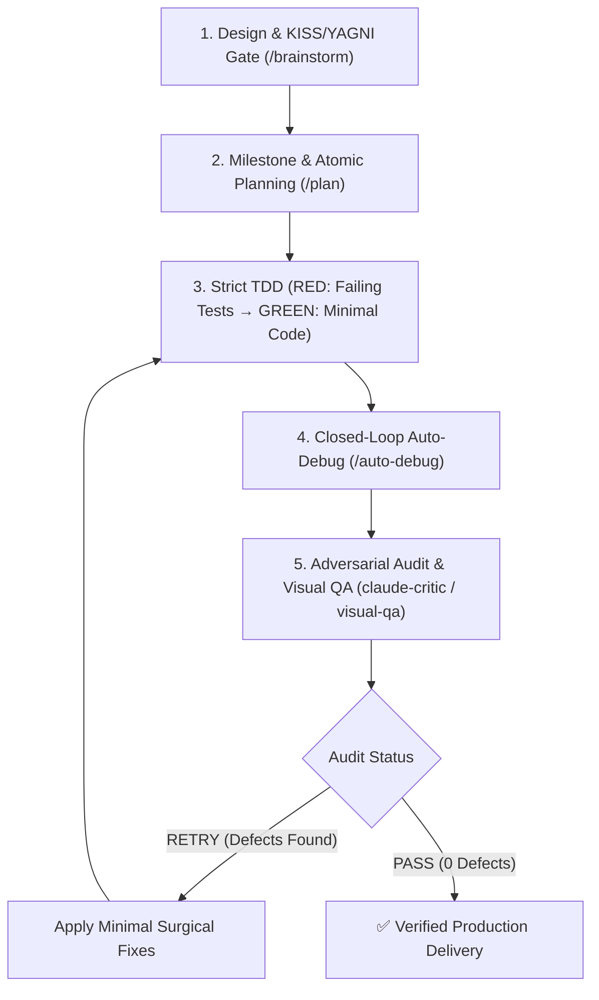

# 🚀 Antigravity Dev Suite (Claude Opus 5.5 + ASD-STE100 v1.7.0)

**Enterprise-Grade, 100% Cross-Platform Development & Cognitive Reasoning Suite for Google Antigravity (AGY)**.  
Combines the best engineering patterns from **`mega-mind`**, **`ECC (Everything Claude Code)`**, **`superpowers`**, the **Claude Opus 5.5 Standard**, and **ASD-STE100 (Simplified Technical English)**. Calibrated for maximum efficiency with **Flash and Pro models** across **macOS (Intel & Apple Silicon), Linux, and Windows 10/11**.

---

## 📐 ASD-STE100 Technical Communication Standard
The suite strictly enforces ASD-STE100 across all agent interactions, diagnostic reports, and code comments:
- **Active Voice & Imperative Mood**: Direct procedural instructions (`Execute test suite`, `Validate inputs`).
- **Controlled Sentence Length**: Maximum 20 words per procedural instruction, maximum 25 words per descriptive sentence.
- **Unambiguous Terminology**: One word = one meaning; zero conversational filler, jargon, or pleasantries.
- **Deterministic Tables & Schemas**: Dense tabular outputs, atomic tasks, and clickable markdown links.

---

## ⚡ Complete Slash Commands Matrix

Every skill in the suite is exposed as a first-class native slash command in Antigravity:

| Slash Command | Skill Module | Cognitive Phase | Key Capabilities |
| :--- | :--- | :--- | :--- |
| **`/opus-dev`** | `skills/opus-dev` | **Autonomous Meta-Engine** | Autonomous closed-loop engineering (*Design & KISS Gate $\to$ Plan $\to$ TDD $\to$ Auto-Debug $\to$ Adversarial Critic Loop until `PASS`*). |
| **`/brainstorm`**| `skills/brainstorm`| **Ideation & Architecture** | Explores **2-3 architectural approaches**, evaluates KISS/YAGNI trade-off matrix, defines negative constraints. |
| **`/plan`** | `skills/plan` | **Milestone Decomposition** | Breaks down tasks into atomic Red-Green steps (1-2 files per task) with explicit TDD targets. |
| **`/auto-debug`**| `skills/auto-debug` | **Closed-Loop Auto-Fix** | Auto-detects 10+ test frameworks, parses stacktraces at AST level, auto-fixes up to 3 cycles. |
| **`/code-review`**|`skills/code-review`| **Adversarial Audit** | **4-Pass Inspection**: Invariants & KISS/YAGNI, Concurrency & Leaks, OWASP Top 10 Security, Strict Typing. |
| **`/refactor`** | `skills/refactor` | **Tech Debt Remediation** | Safe refactoring & KISS simplification with baseline verification, preserving 100% green tests and public APIs. |
| **`/visual-qa`** | `skills/visual-qa` | **Multimodal UI Inspector** | Dual-viewport Playwright screenshots (**Desktop 1280x800 + Mobile 375x667 iPhone SE**). |

---

## 🔄 Autonomous Closed-Loop Verification Pipeline (`/opus-dev`)



---

## 🤖 Specialized Subagent Personas

| Subagent | Persona File | Role & Expertise |
| :--- | :--- | :--- |
| **`opus-architect`** | `agents/opus-architect.md` | System design, design pattern selection, complexity analysis ($O(n)$), KISS/YAGNI anti-overengineering gate, and API stability. |
| **`claude-critic`** | `agents/claude-critic.md` | Strict 7-pillar adversarial inspector for negative constraints, KISS/YAGNI compliance, concurrency, edge cases, and OWASP Top 10 vulnerabilities. |
| **`visual-qa-critic`**| `agents/visual-qa-critic.md`| Multimodal UI/UX and accessibility critic inspecting mobile horizontal overflow, tap targets (≥44px), and console errors. |

---

## 🌐 100% Cross-Platform Native Architecture

- **🍎 macOS (Apple Silicon & Intel)**: Adaptive Chromium launcher with process isolation for sandboxed execution and rapid non-blocking dual-stack socket probing.
- **🐧 Linux (Debian, Ubuntu, RHEL, Fedora, Arch, Alpine)**: Memory-isolated headless browser runner with non-blocking fallback-safe execution.
- **🪟 Windows 10/11 (PowerShell 5.1 & 7+)**: 1-click installation via native NTFS Directory Junctions (`New-Item -ItemType Junction`) and BOM-less UTF-8 configuration writing.

---

## 📁 Directory Structure

```text
antigravity-dev-suite/
├── plugin.json                 # Standard AGY plugin manifest (v1.7.0)
├── hooks.json                  # Root PostToolUse hook configuration (Universal dispatch)
├── mcp_config.json             # Root Playwright MCP server definition
├── agents/                     # Subagent personas (Native Markdown)
│   ├── opus-architect.md       # System design & scalability architect
│   ├── claude-critic.md        # Adversarial logic & constraints critic (Opus 5.5 Standard)
│   └── visual-qa-critic.md     # Multimodal visual QA critic (Dual-Viewport)
├── rules/                      # System rules injected into context
│   └── AGENTS.md               # Master Claude Opus 5.5 Enterprise Rulebook
├── skills/                     # Skill modules & First-Class Slash Commands
│   ├── opus-dev/SKILL.md       # /opus-dev: Unified autonomous engineering meta-engine
│   ├── brainstorm/SKILL.md     # /brainstorm: Architectural trade-off analysis
│   ├── plan/SKILL.md           # /plan: Atomic milestone & TDD planning
│   ├── auto-debug/SKILL.md     # /auto-debug: Multi-ecosystem closed-loop auto-debugger
│   ├── code-review/SKILL.md    # /code-review: 4-Pass adversarial security & typing gate
│   ├── refactor/SKILL.md       # /refactor: Safe tech debt remediation with invariants
│   └── visual-qa/SKILL.md      # /visual-qa: Dual-viewport Playwright visual QA skill
├── scripts/                    # Runtime runner scripts (Pure Python / Cross-Platform)
│   ├── validator_core.py       # Core AST, regex, JSONC, Rust/C++ raw strings and delimiter parser
│   ├── auto_debug_runner.py    # Universal PostToolUse hook processor & syntax validator
│   ├── critic_loop.py          # Critic loop orchestrator CLI (Opus 5.5 Standard)
│   ├── visual_qa.py            # Playwright dual-viewport screenshot engine (Platform-adaptive)
│   ├── clean_legacy_plugins.sh # Conflicting plugins cleaner (macOS & Linux)
│   └── clean_legacy_plugins.ps1# Conflicting plugins cleaner (Windows PowerShell)
├── tests/                      # Automated Verification & TDD Suite
│   └── test_plugin_suite.py    # Full unit and integration test suite (18 automated checks)
├── templates/                  # Zero-setup per-repository template
│   └── project-git-template/   # .agents/ & GEMINI.md template for team sharing
├── install.sh                  # 1-Click installer for macOS & Linux
├── install.ps1                 # 1-Click installer for Windows (PowerShell)
├── uninstall.sh                # Clean uninstaller for macOS & Linux
└── uninstall.ps1               # Clean uninstaller for Windows (PowerShell)
```

---

## 📦 1-Click Installation

### 🍎 macOS & 🐧 Linux
```bash
cd antigravity-dev-suite
chmod +x install.sh
./install.sh
```

### 🪟 Windows (PowerShell 5.1 / 7+)
```powershell
cd antigravity-dev-suite
.\install.ps1
```

---

## 👥 Zero-Setup Team Sharing (Per-Repository)

To enable these rules, skills, and subagents for all team members on a specific repository:

1. Copy the template into your project root:
   ```bash
   cp -r templates/project-git-template/* /path/to/your/project/
   ```
2. Commit and push:
   ```bash
   git add GEMINI.md .agents/
   git commit -m "chore: enable Antigravity Dev Suite & Claude Opus 5.5 skills"
   git push
   ```

---

## 🛠️ Testing & Verification Suite

Execute the built-in automated test suite:

```bash
# Run Complete Test Suite
python3 tests/test_plugin_suite.py

# Test Visual QA Screenshot Engine directly
python3 scripts/visual_qa.py --test-mode

# Test Critic Loop Orchestrator
python3 scripts/critic_loop.py --mode all --test-mode
```

---

## 📄 License
Internal Enterprise License — UniCredit Group.
