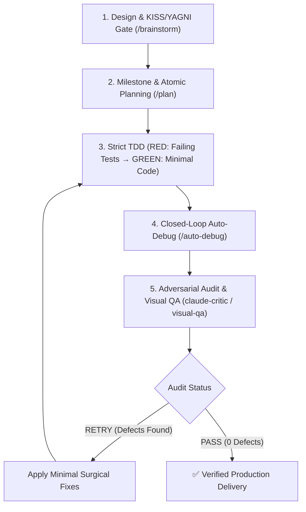

# 🚀 Antigravity Dev Suite (Claude Opus 5.5 + ASD-STE100 v1.16.0)

**Enterprise-Grade, 100% Cross-Platform Development & Cognitive Reasoning Suite for Google Antigravity (AGY)**.  
Combines the best engineering patterns from **`mega-mind`**, **`ECC (Everything Claude Code)`**, **`superpowers`**, the **Claude Opus 5.5 Standard**, and **ASD-STE100 (Simplified Technical English)**. Calibrated for maximum efficiency with **Gemini Flash 3.8 and model inheritance** across **macOS (Intel & Apple Silicon), Linux, and Windows 10/11**.

---

## 📐 ASD-STE100 Technical Communication Standard
The suite strictly enforces ASD-STE100 across all agent interactions, diagnostic reports, and code comments:
- **Active Voice & Imperative Mood**: Direct procedural instructions (`Execute test suite`, `Validate inputs`).
- **Controlled Sentence Length**: Maximum 20 words per procedural instruction, maximum 25 words per descriptive sentence.
- **Unambiguous Terminology**: One word = one meaning; zero conversational filler, jargon, or pleasantries.
- **Deterministic Tables & Schemas**: Dense tabular outputs, atomic tasks, and clickable markdown links.

---

## ⚡ Complete Slash Commands Matrix

Every skill in the suite is exposed as a first-class native slash command in Antigravity:

| Slash Command | Skill Module | Cognitive Phase | Key Capabilities |
| :--- | :--- | :--- | :--- |
| **`/opus-dev`** | `skills/opus-dev` | **Autonomous Meta-Engine** | Autonomous closed-loop engineering (*Design & Invariants $\to$ Plan $\to$ TDD & Properties $\to$ Auto-Debug & Benchmark $\to$ Adversarial Critic Loop until `PASS`*). |
| **`/brainstorm`**| `skills/brainstorm`| **Ideation & Architecture** | Explores **2-3 architectural approaches**, evaluates KISS/YAGNI trade-off matrix, defines algorithmic bounds ($O(n)$) and formal inductive invariants ($P, I, V, Q$). |
| **`/plan`** | `skills/plan` | **Milestone Decomposition** | Breaks down tasks into atomic Red-Green steps with explicit TDD targets, typestate transitions, and formal inductive invariants. |
| **`/auto-debug`**| `skills/auto-debug` | **Closed-Loop Auto-Fix** | Auto-detects 10+ test, coverage & mutation frameworks, parses stacktraces at AST level, auto-fixes up to 3 cycles. |
| **`/code-review`**|`skills/code-review`| **Adversarial Audit** | **5-Pass Inspection**: Invariants & Bounds, Concurrency & Leaks, OWASP Top 10 Security, Typestate & Strict Types, Property Fuzzing & Mutation Gate. |
| **`/commit`** | `skills/commit` | **Pre-Commit Verification** | 4-Phase pre-commit pipeline executing secret scans, static audits, test validation, and Conventional Commits formatting. |
| **`/benchmark`** | `skills/benchmark` | **Performance & Hotspots** | 4-Phase microbenchmark & profiling harness (Ecosystem detection, Hotspots $O(n^2)$, Memory leaks, >5% regression threshold). |
| **`/refactor`** | `skills/refactor` | **Tech Debt Remediation** | Safe refactoring & KISS simplification with baseline verification, preserving 100% green tests and public APIs. |
| **`/visual-qa`** | `skills/visual-qa` | **Multimodal UI Inspector** | Dual-viewport Playwright screenshots (**Desktop 1280x800 + Mobile 375x667 iPhone SE**). |
| **`/security-audit`** | `skills/security-audit` | **Vulnerability Harness** | Cloudflare 4-phase audit (Recon, Coverage Sweeps, Hunter/Verifier, Supply Chain CVEs, `findings.json` & `SECURITY-REPORT.md`). |
| **`/handoff`** | `skills/handoff` | **Session Context Preservation** | Exports portable Markdown briefing to temp directory with telemetry (`PASS`), git state, secret scrubbing, and next skill pointers. |

---

## 🔄 Autonomous Closed-Loop Verification Pipeline (`/opus-dev`)



---

## 🤖 Specialized Subagent Personas

All subagents configure `model: inherit` to preserve parent execution speed and eliminate model initialization delays:

| Subagent | Persona File | Model | Role & Expertise |
| :--- | :--- | :--- | :--- |
| **`opus-architect`** | `agents/opus-architect.md` | `inherit` | System design, design pattern selection, complexity analysis ($O(n)$), KISS/YAGNI anti-overengineering gate, and API stability. |
| **`claude-critic`** | `agents/claude-critic.md` | `inherit` | Strict 7-pillar adversarial inspector for negative constraints, KISS/YAGNI compliance, concurrency, edge cases, and OWASP Top 10 vulnerabilities. |
| **`visual-qa-critic`**| `agents/visual-qa-critic.md`| `inherit` | Multimodal UI/UX and accessibility critic inspecting mobile horizontal overflow, tap targets (≥44px), and console errors. |

---

## ⚡ Gemini Flash 3.8 Acceleration & Caching Architecture

The suite implements local deterministic caching and token hygiene to maximize Gemini Flash 3.8 performance without latency bottlenecks:
- **Persistent `mtime` Disk Cache (`scripts/repo_map.py`)**: Stores file symbol maps at `.gemini/cache/repo_map_cache.json`. Incremental scanning skips unchanged files and provides sub-5ms symbol resolution.
- **AST Semantic Slicing (`scripts/semantic_slice.py`)**: Extracts only targeted functions or classes, avoiding multi-hundred-line file reads and context dilution.
- **Stream Output Condensation (`scripts/auto_debug_runner.py`)**: Filters noisy framework frames and caps failure assertion diffs to $\le 30$ lines.
- **Spec-First Formal Invariant Matrices**: Mandates pre-conditions, post-conditions, and invariant contracts prior to writing code, enabling first-pass correctness.
- **Zero-Pro Subagent Inheritance**: Enforces `model: inherit` on all subagents to eliminate heavy model switching delays.

---

## 🌐 100% Cross-Platform Native Architecture

The suite operates across all major operating systems without native compilation dependencies:

| Operating System | Architecture / Shell | Linking Mechanism | Permissions & Requirements |
| :--- | :--- | :--- | :--- |
| **🍎 macOS** | Intel x86_64, Apple Silicon (M1/M2/M3/M4) / `zsh`, `bash` | POSIX Symbolic Link (`ln -sf`) | Python 3.10+, User permissions |
| **🐧 Linux** | Debian, Ubuntu, RHEL, Fedora, Arch, Alpine / `bash` | POSIX Symbolic Link (`ln -sf`) | Python 3.10+, User permissions |
| **🪟 Windows 10/11** | x86_64, ARM64 / PowerShell 5.1 & PowerShell Core 7+ | Native NTFS Directory Junction | Python 3.10+, **No Administrator required** |

- **Pure Python Standard Library**: Core runtime scripts ([`validator_core.py`](scripts/validator_core.py), [`critic_loop.py`](scripts/critic_loop.py), [`semantic_slice.py`](scripts/semantic_slice.py), [`api_contract_guard.py`](scripts/api_contract_guard.py)) use only Python built-in modules (`ast`, `re`, `json`, `pathlib`).
- **Zero Windows Developer Mode Requirement**: Windows uses native NTFS Directory Junctions (`New-Item -ItemType Junction`) avoiding Developer Mode or elevated Administrator prompts.
- **Resilient Fallback Design**: Playwright is used for visual QA; when unavailable, all linting, TDD, auto-debug, and code review capabilities remain 100% operational.

---

## 📁 Directory Structure

```text
antigravity-dev-suite/
├── plugin.json                 # Standard AGY plugin manifest (v1.16.0)
├── hooks.json                  # Root PreToolUse & PostToolUse hook configuration
├── mcp_config.json             # Root Playwright MCP server definition
├── agents/                     # Subagent personas (Native Markdown, model: inherit)
│   ├── opus-architect.md       # System design, ADR persistence & scalability architect
│   ├── claude-critic.md        # Adversarial logic, migration & constraints critic (Opus 5.5 Standard)
│   └── visual-qa-critic.md     # Multimodal visual QA critic (Dual-Viewport)
├── rules/                      # System rules injected into context
│   ├── AGENTS.md               # Master Claude Opus 5.5 Enterprise Rulebook (16 Architectural Rules)
│   ├── database/               # Database migration and zero-downtime evolution rules
│   └── languages/              # Multi-language strict type-safety & idiomatic guidelines
├── skills/                     # Skill modules & First-Class Slash Commands
│   ├── opus-dev/SKILL.md       # /opus-dev: Unified autonomous engineering meta-engine
│   ├── brainstorm/SKILL.md     # /brainstorm: Architectural trade-off analysis & ADR persistence
│   ├── plan/SKILL.md           # /plan: Atomic milestone & TDD planning with Formal Invariant Matrix
│   ├── auto-debug/SKILL.md     # /auto-debug: Multi-ecosystem closed-loop auto-debugger (Tests, Types, Race, Fuzz)
│   ├── code-review/            # /code-review: 5-Pass adversarial security, invariants & typing gate
│   │   ├── SKILL.md            # Multi-pass code review workflow
│   │   └── references/         # Modular pattern reference catalog
│   ├── commit/SKILL.md         # /commit: Pre-commit verification pipeline & Conventional Commits
│   ├── benchmark/SKILL.md      # /benchmark: Microbenchmark & latency profiling harness
│   ├── refactor/SKILL.md       # /refactor: Safe tech debt remediation with invariants
│   ├── visual-qa/SKILL.md      # /visual-qa: Dual-viewport Playwright visual QA skill
│   ├── security-audit/         # /security-audit: Cloudflare-inspired vulnerability harness
│   └── handoff/SKILL.md        # /handoff: Cross-platform session handoff briefing generator
├── scripts/                    # Runtime runner scripts (Pure Python / Cross-Platform)
│   ├── validator_core.py       # Core AST, regex, JSONC, polyglot raw strings, and delimiter parser
│   ├── auto_debug_runner.py    # PostToolUse processor, tests, typecheck, race, fuzz, flaky runner & stream filter
│   ├── semantic_slice.py       # AST & brace symbol slicer for Flash 3.8 context hygiene
│   ├── api_contract_guard.py   # Automated public API contract drift detector (Python, TS, Go, Rust)
│   ├── repo_map.py             # Token-budgeted repository symbol mapper with persistent mtime cache
│   ├── handoff.py              # Standalone session handoff generator with secret redaction
│   ├── stop_gate.py            # Dual-gate completion validator (test & critic pass enforcement)
│   ├── diff_guard.py           # AST diff hygiene & cognitive complexity analyzer
│   ├── symbol_impact.py        # Polyglot symbol dependency and blast radius tracer
│   ├── test_scaffolder.py      # Automated boundary and edge-case test scaffolder
│   ├── install_git_hooks.py    # Native cross-platform pre-commit Git hook installer
│   ├── pre_tool_guard.py       # PreToolUse safety guardrail (Blocks catastrophic commands & leaks)
│   ├── critic_loop.py          # Critic loop orchestrator CLI (Opus 5.5 Standard)
│   └── visual_qa.py            # Playwright dual-viewport screenshot engine with WCAG 2.1 AA a11y audit
├── tests/                      # Automated Verification & TDD Suite
│   └── test_plugin_suite.py    # Full unit and integration test suite (400+ automated checks)
├── templates/                  # Zero-setup per-repository template
│   └── project-git-template/   # .agents/ & GEMINI.md template for team sharing
├── install.sh                  # 1-Click installer for macOS & Linux
├── install.ps1                 # 1-Click installer for Windows (PowerShell)
├── uninstall.sh                # Clean uninstaller for macOS & Linux
└── uninstall.ps1               # Clean uninstaller for Windows (PowerShell)
```

---

## 📦 1-Click Installation

### 🍎 macOS & 🐧 Linux
```bash
# Clone repository
git clone https://ghb.internal.unicreditgroup.eu/scm/~c332376/antigravity-dev-suite.git
cd antigravity-dev-suite

# Run 1-Click installer
chmod +x install.sh
./install.sh

# Optional: Install Playwright Chromium browser binaries (~150MB)
./install.sh --with-browsers
# or set AGY_INSTALL_BROWSERS=1 ./install.sh
```

### 🪟 Windows (PowerShell 5.1 / 7+)
```powershell
# Clone repository
git clone https://ghb.internal.unicreditgroup.eu/scm/~c332376/antigravity-dev-suite.git
cd antigravity-dev-suite

# Run 1-Click installer
.\install.ps1

# Optional: Install Playwright Chromium browser binaries
.\install.ps1 -WithBrowsers
```

---

## 🔄 Updating to Latest Version

Because installation creates a symbolic link (macOS/Linux) or NTFS Directory Junction (Windows) pointing directly to the Git repository folder, updates become **active immediately** in Antigravity without reinstalling.

### macOS & Linux
```bash
# 1. Navigate to the local repository directory
cd /path/to/antigravity-dev-suite

# 2. Pull latest commits from main branch
git pull origin main

# 3. Verify suite integrity (optional)
python3 tests/test_plugin_suite.py
```

### Windows (PowerShell)
```powershell
# 1. Navigate to the local repository directory
cd C:\path\to\antigravity-dev-suite

# 2. Pull latest commits from main branch
git pull origin main

# 3. Verify suite integrity (optional)
python tests\test_plugin_suite.py
```

---

## ⚡ CLI Utilities & Diagnostic Tools

Every component includes standalone CLI execution for terminal inspection:

### 1. Auto-Debug Runner (`auto_debug_runner.py`)
```bash
# Auto-detect ecosystem and test/lint commands (10+ ecosystems)
python3 scripts/auto_debug_runner.py --detect

# Run detected test suite autonomously
python3 scripts/auto_debug_runner.py --run-tests

# Run static typecheck autonomously
python3 scripts/auto_debug_runner.py --typecheck

# Run concurrency race detector
python3 scripts/auto_debug_runner.py --race

# Run property-based fuzz tests
python3 scripts/auto_debug_runner.py --fuzz

# Run test coverage analyzer
python3 scripts/auto_debug_runner.py --coverage

# Run mutation testing suite (full or diff-scoped)
python3 scripts/auto_debug_runner.py --mutation
python3 scripts/auto_debug_runner.py --mutation --diff

# Run multi-iteration race and flaky test detector
python3 scripts/auto_debug_runner.py --detect-flaky
python3 scripts/auto_debug_runner.py --detect-flaky -n 5

# Run detected microbenchmarks autonomously
python3 scripts/auto_debug_runner.py --benchmark

# Install pre-commit Git hook for local repo
python3 scripts/auto_debug_runner.py --install-git-hooks

# Validate single file syntax and bracket balance
python3 scripts/auto_debug_runner.py --check <path/to/file>

# Read cached syntax error from recent hook execution
python3 scripts/auto_debug_runner.py --last-error

# Clear cached syntax error
python3 scripts/auto_debug_runner.py --clear-last-error
```

### 2. Pre-Commit Git Hook Installer (`install_git_hooks.py`)
```bash
# Install automated pre-commit hook into .git/hooks/pre-commit
python3 scripts/install_git_hooks.py --install

# Check installation status
python3 scripts/install_git_hooks.py --status

# Uninstall pre-commit hook
python3 scripts/install_git_hooks.py --uninstall
```

### 3. Critic Loop Orchestrator (`critic_loop.py`)
```bash
# Run full static audit across target directory
python3 scripts/critic_loop.py --mode all --target .

# Run semantic AST audit (mutable defaults, ReDoS, unawaited promises)
python3 scripts/critic_loop.py --mode semantic --target .

# Run syntax and bracket validation only
python3 scripts/critic_loop.py --mode syntax --target src/

# Run OWASP Top 10 secrets and empty exception scans only
python3 scripts/critic_loop.py --mode security --target .

# Inspect synthetic self-test mode
python3 scripts/critic_loop.py --mode all --test-mode
```

### 4. Public API Contract Drift Guard (`api_contract_guard.py`)
```bash
# Audit workspace for breaking changes against git HEAD
python3 scripts/api_contract_guard.py --target .

# Audit against a specific git base reference (e.g. main branch)
python3 scripts/api_contract_guard.py --base-ref main --target .

# Compare two explicit files directly
python3 scripts/api_contract_guard.py --base-file base.py --candidate-file new.py

# Emit machine-readable JSON report
python3 scripts/api_contract_guard.py --target . --json
```

### 5. Repository Topology Mapper (`repo_map.py`)
```bash
# Generate token-budgeted repository symbol map
python3 scripts/repo_map.py .

# Customize token budget limit (default: 2048)
python3 scripts/repo_map.py . --max-tokens 4096

# Restrict scan depth to maximum file count
python3 scripts/repo_map.py . --max-files 200

# Emit machine-readable JSON symbol map
python3 scripts/repo_map.py . --json
```

### 6. Visual QA & WCAG 2.1 AA Accessibility Inspector (`visual_qa.py`)
```bash
# Capture dual-viewport screenshots and audit WCAG 2.1 AA accessibility
python3 scripts/visual_qa.py

# Inspect explicit target HTML file or URL
python3 scripts/visual_qa.py index.html
python3 scripts/visual_qa.py http://localhost:3000

# Target specific dev server URL or port
python3 scripts/visual_qa.py --dev-server http://localhost:5173
python3 scripts/visual_qa.py --port 3000

# Run in self-test synthetic mode
python3 scripts/visual_qa.py --test-mode
```

### 7. Semantic Symbol Slicer (`semantic_slice.py`)
```bash
# Extract specific function or class AST slice from Python or TS/JS file
python3 scripts/semantic_slice.py path/to/file.py --symbol my_function

# Extract symbol slice along with file-level imports and dependencies
python3 scripts/semantic_slice.py path/to/file.py --symbol MyClass --with-imports

# Extract symbol containing specific line number
python3 scripts/semantic_slice.py path/to/file.ts --line 142

# List all top-level symbols in file without reading file body
python3 scripts/semantic_slice.py path/to/file.py --list

# Emit compact minified output for Gemini Flash 3.8 prompt hygiene
python3 scripts/semantic_slice.py path/to/file.py --symbol process_data --compact
```

### 8. Autonomous Multi-Pass Audit Loops
```bash
# Unix (macOS / Linux)
./scripts/run_audit_loop.sh -n 3 -m all -w .

# Windows (PowerShell)
.\scripts\run_audit_loop.ps1 -MaxCycles 3 -Mode all -WorkspacePath .
```

---

## 👥 Zero-Setup Team Sharing (Per-Repository)

To enable these rules, skills, and subagents for all team members on a specific repository:

1. Copy the template into your project root:
   ```bash
   cp -r templates/project-git-template/* /path/to/your/project/
   ```
2. Commit and push:
   ```bash
   git add GEMINI.md .agents/
   git commit -m "chore: enable Antigravity Dev Suite & Claude Opus 5.5 skills"
   git push
   ```

---

## 🛠️ Testing & Verification Suite

Execute the built-in automated test suite:

```bash
# Run Complete Test Suite
python3 tests/test_plugin_suite.py

# Test Visual QA Screenshot Engine directly
python3 scripts/visual_qa.py --test-mode

# Test Critic Loop Orchestrator
python3 scripts/critic_loop.py --mode all --test-mode
```

---

## 📄 License
Internal Enterprise License — UniCredit Group.
