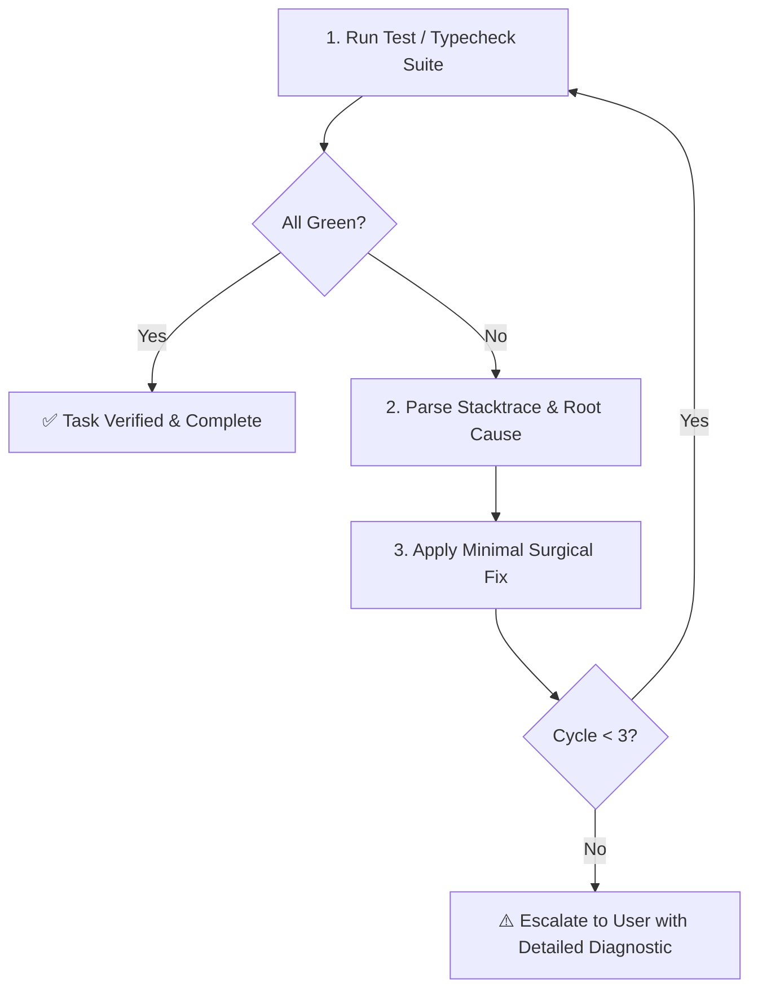

# 🔧 Auto-Debug Skill (Autonomous Closed-Loop Debugger)

Use this skill to autonomously execute the project's test suite, capture build/typecheck/lint failures, and fix them in a closed loop before marking a task complete.

---

## 🛠️ Framework Detection & Test Runner Matrix

Detect and execute the appropriate test command based on the project configuration:

| Ecosystem | Config File / Marker | Test Command | Typecheck / Lint Command |
| :--- | :--- | :--- | :--- |
| **Node / TS (Vitest)** | `vite.config.ts`, `vitest.config.ts` | `npx vitest run` / `npm test` | `npx tsc --noEmit && npx eslint .` |
| **Node / JS (Jest)** | `jest.config.js`, `package.json` | `npx jest --bail` / `npm test` | `npx tsc --noEmit` |
| **Bun** | `bun.lockb`, `bunfig.toml` | `bun test` | `bunx tsc --noEmit && bunx eslint .` |
| **Deno** | `deno.json`, `deno.jsonc` | `deno test` | `deno lint && deno check` |
| **pnpm** | `pnpm-lock.yaml` | `pnpm test` | `pnpm run typecheck` |
| **Python (pytest)** | `pytest.ini`, `pyproject.toml`, `tests/` | `pytest -v` / `python -m pytest` | `ruff check . && mypy .` / `pyright` |
| **Python (uv)** | `uv.lock` | `uv run pytest` | `uv run ruff check . && uv run mypy .` |
| **Rust (Cargo)** | `Cargo.toml` | `cargo test` | `cargo clippy --all-targets` |
| **Go** | `go.mod` | `go test -v ./...` | `go vet ./... && staticcheck ./...` |
| **Java / Kotlin** | `pom.xml` / `build.gradle` | `mvn test` / `./gradlew test` | `mvn compile` / `./gradlew check` |
| **.NET / C#** | `*.csproj`, `*.sln` | `dotnet test` | `dotnet build` |
| **C / C++ (CMake / CTest)** | `CMakeLists.txt` | `ctest --output-on-failure` | `cmake --build build` |
| **Ruby (RSpec)** | `Gemfile`, `.rspec` | `bundle exec rspec` | `bundle exec rubocop` |
| **PHP (PHPUnit)** | `phpunit.xml`, `composer.json` | `vendor/bin/phpunit` | `vendor/bin/phpstan analyse` |
| **Swift** | `Package.swift` | `swift test` | `swift build` |

---

## 🔄 Closed-Loop Auto-Debug Workflow



### Protocol Steps:
1. **Discover & Execute**: Run the detected test runner in background or synchronously.
2. **Isolate Root Cause**: Read the full stacktrace. Pinpoint the exact file, line number, and AST node causing the fault.
3. **Avoid Guessing**: Never silence errors with empty try/catch blocks or blind type assertions (`as any`). Fix the underlying logic or invariant.
4. **Iterative Verification**: Apply minimal targeted edits and re-run tests. Allow up to 3 autonomous cycles.
5. **Report Evidence**: Provide the terminal verification output as conclusive evidence.

---

## ⚡ Auto-Debug Runner Utility (CLI)

Use the diagnostic and test execution CLI utility:

```bash
# Detect project framework and recommended commands
python3 scripts/auto_debug_runner.py --detect

# Run detected test command autonomously
python3 scripts/auto_debug_runner.py --run-tests

# Validate single file syntax and bracket balance
python3 scripts/auto_debug_runner.py --check <path/to/file>

# Read cached syntax error from recent hook execution
python3 scripts/auto_debug_runner.py --last-error

# Clear cached syntax error
python3 scripts/auto_debug_runner.py --clear-last-error
```
