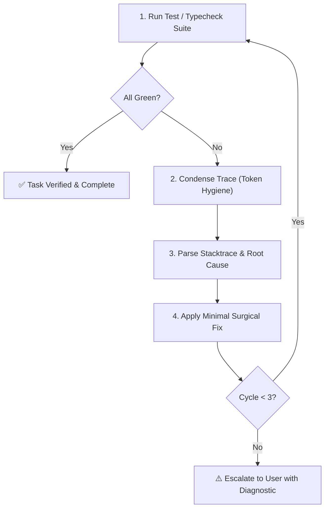

# 🔧 Auto-Debug Skill (Autonomous Closed-Loop Debugger)

> **Paths**: `scripts/` is the suite folder, not your project: `~/.gemini/config/plugins/antigravity-dev-suite/scripts/`. On Windows use `py -3` instead of `python3`. The Stop gate runs the checks again when you finish.

Use this skill to autonomously execute the project's test suite, static typechecker, race detector, fuzz harness, capture failures, and fix them in a closed loop before marking a task complete.

---

## 🛠️ Framework Detection & Test Runner Matrix

Detect and execute the appropriate test command based on the project configuration:

| Ecosystem | Config File / Marker | Test Command | Typecheck / Lint Command | Concurrency Race Command | Fuzzing Command |
| :--- | :--- | :--- | :--- | :--- | :--- |
| **Node / TS (Vitest)** | `vite.config.ts`, `vitest.config.ts` | `npx vitest run` / `npm test` | `npx tsc --noEmit && npx eslint .` | N/A | `npx fast-check` |
| **Node / JS (Jest)** | `jest.config.js`, `package.json` | `npx jest --bail` / `npm test` | `npx tsc --noEmit` | N/A | `npx fast-check` |
| **Bun** | `bun.lockb`, `bunfig.toml` | `bun test` | `bunx tsc --noEmit && bunx eslint .` | N/A | `bun test` |
| **Deno** | `deno.json`, `deno.jsonc` | `deno test` | `deno lint && deno check` | N/A | `deno test` |
| **pnpm** | `pnpm-lock.yaml` | `pnpm test` | `pnpm run typecheck` | N/A | `pnpm test` |
| **Python (pytest)** | `pytest.ini`, `pyproject.toml`, `tests/` | `pytest -v` / `python -m pytest` | `ruff check . && mypy .` / `pyright` | `pytest -p no:threadsafe` | `pytest -m hypothesis` / `hypothesis` |
| **Python (uv)** | `uv.lock` | `uv run pytest` | `uv run ruff check . && uv run mypy .` | `uv run pytest` | `uv run pytest -m hypothesis` |
| **Rust (Cargo)** | `Cargo.toml` | `cargo test` | `cargo clippy --all-targets` | `cargo test` | `cargo fuzz run` / `cargo test` |
| **Go** | `go.mod` | `go test -v ./...` | `go vet ./... && staticcheck ./...` | `go test -race ./...` | `go test -fuzz=. -fuzztime=10s` |
| **Java / Kotlin** | `pom.xml` / `build.gradle` | `mvn test` / `./gradlew test` | `mvn compile` / `./gradlew check` | `./gradlew test` | `mvn jqwik:test` / `./gradlew jqwik` |
| **.NET / C#** | `*.csproj`, `*.sln` | `dotnet test` | `dotnet build` | `dotnet test` | `dotnet test` |
| **C / C++ (CMake)** | `CMakeLists.txt` | `ctest --output-on-failure` | `cmake --build build` | `ctest` | `ctest` |
| **Ruby (RSpec)** | `Gemfile`, `.rspec` | `bundle exec rspec` | `bundle exec rubocop` | `bundle exec rspec` | `bundle exec rspec` |
| **PHP (PHPUnit)** | `phpunit.xml`, `composer.json` | `vendor/bin/phpunit` | `vendor/bin/phpstan analyse` | `vendor/bin/phpunit` | `vendor/bin/phpunit` |
| **Swift** | `Package.swift` | `swift test` | `swift build` | `swift test --sanitize=thread` | `swift test` |

---

## 🔄 Closed-Loop Auto-Debug Workflow



### Protocol Steps:
1. **Discover & Execute**: Run the detected test, typecheck, or race detector runner.
2. **Condense Output (Token Hygiene)**: Strip noisy passing assertions. Retain failing files, lines, and error messages within 120 lines / 4KB to save context window tokens.
3. **Isolate Root Cause**: Read condensed trace. Pinpoint exact file, line number, and AST node causing the fault.
4. **Avoid Guessing**: Never silence errors with empty catch blocks or blind casts. Fix underlying logic or invariants.
5. **Iterative Verification**: Apply minimal targeted edits and re-run suite. Allow up to 3 autonomous cycles.
6. **Report Evidence**: Provide terminal verification output as conclusive evidence.

---

## ⚡ Auto-Debug Runner Utility (CLI)

Use the diagnostic and test execution CLI utility:

```bash
# Detect project framework and recommended commands
python3 ~/.gemini/config/plugins/antigravity-dev-suite/scripts/auto_debug_runner.py --detect

# Run detected test command autonomously
python3 ~/.gemini/config/plugins/antigravity-dev-suite/scripts/auto_debug_runner.py --run-tests

# Run static typecheck command
python3 ~/.gemini/config/plugins/antigravity-dev-suite/scripts/auto_debug_runner.py --typecheck

# Run concurrency race detection
python3 ~/.gemini/config/plugins/antigravity-dev-suite/scripts/auto_debug_runner.py --race

# Run property-based fuzzing tests
python3 ~/.gemini/config/plugins/antigravity-dev-suite/scripts/auto_debug_runner.py --fuzz

# Run test coverage analyzer
python3 ~/.gemini/config/plugins/antigravity-dev-suite/scripts/auto_debug_runner.py --coverage

# Run mutation testing suite
python3 ~/.gemini/config/plugins/antigravity-dev-suite/scripts/auto_debug_runner.py --mutation

# Install pre-commit Git hook for local repo
python3 ~/.gemini/config/plugins/antigravity-dev-suite/scripts/auto_debug_runner.py --install-git-hooks

# Validate single file syntax and bracket balance
python3 ~/.gemini/config/plugins/antigravity-dev-suite/scripts/auto_debug_runner.py --check <path/to/file>

# Run the full verification gate (same checks as the Stop hook)
python3 ~/.gemini/config/plugins/antigravity-dev-suite/scripts/agy_hook.py check
```
