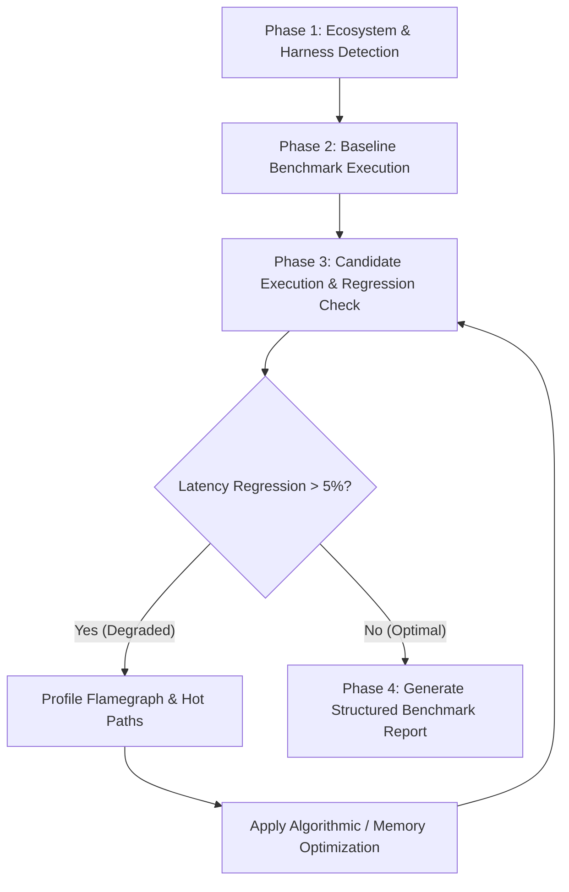

# ⚡ Performance Benchmarking & Profiling Engine (`/benchmark`)

Use this skill to measure execution throughput, detect latency regressions, profile memory allocations, and identify algorithmic bottlenecks before merging code changes.

---

## 🏎️ 4-Phase Performance Profiling Pipeline



---

### Phase 1: Benchmark Harness Detection

The engine detects project benchmark harnesses using `scripts/auto_debug_runner.py --benchmark`:

| Ecosystem | Benchmark Command | Configuration & Markers |
| :--- | :--- | :--- |
| **Rust** | `cargo bench` | `benches/`, `Criterion.rs` |
| **Go** | `go test -bench=. -benchmem ./...` | `*_test.go` with `Benchmark*` functions |
| **Python** | `pytest -v --benchmark-only` | `pytest-benchmark`, `tests/` |
| **Node / Vitest** | `npx vitest bench` | `vitest.config.ts`, `*.bench.ts` |
| **Bun** | `bun test --bench` | `*.bench.ts`, `bunfig.toml` |
| **Deno** | `deno bench` | `deno.json`, `*_bench.ts` |
| **.NET / C#** | `dotnet test -c Release --filter *Benchmark*` | `BenchmarkDotNet` |

---

### Phase 2: Execution & Algorithmic Bottleneck Audit

Inspect production code for performance traps during benchmark execution:

1. **Quadratic Loop Traps ($O(n^2)$)**:
   - Identify nested loops performing linear lookups (`x in list`).
   - Replace linear collections with hash sets or lookup maps to achieve $O(1)$ lookup time.
2. **Database N+1 Query Traps**:
   - Detect queries executed inside loop iterations across ORMs.
   - Replace with eager loading (`select_related`, `prefetch_related`, `JOIN` queries).
3. **Memory Allocations & Leaks**:
   - Track memory allocation growth (`B/op`, `allocs/op`).
   - Identify unclosed connections, dangling event listeners, and circular references.
4. **Catastrophic Backtracking (ReDoS)**:
   - Verify regular expressions against catastrophic nested quantifiers.

---

### Phase 3: Regression Comparison & Thresholds

Compare candidate metrics against baseline performance:
- **Throughput (ops/sec)**: Alert on drops greater than 5%.
- **Latency (p95 / p99)**: Reject regressions exceeding 5% on hot paths.
- **Memory Allocated**: Reject unneeded allocations on high-frequency paths.

---

### Phase 4: Structured Performance Report Schema

Generate `BENCHMARK-REPORT.md` upon completion:

```markdown
# ⚡ Performance & Benchmark Report

## 📊 Summary Matrix

| Benchmark Target | Baseline (p95) | Candidate (p95) | Delta (%) | Status |
| :--- | :--- | :--- | :--- | :--- |
| `parse_payload()` | 1.42 ms | 1.10 ms | -22.5% | ✅ Faster |
| `filter_records()` | 12.30 ms | 12.45 ms | +1.2% | ✅ Acceptable |

## 🔍 Bottleneck Analysis
- **Hot-Path Allocations**: Removed temporary list allocation at `src/parser.py:84`.
- **Algorithmic Complexity**: Replaced linear list search with hash set ($O(n) \to O(1)$).
- **Final Verdict**: PASS (Zero regressions exceeding 5% threshold).
```
