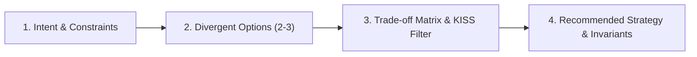

# 🧠 Architectural Brainstorming & Trade-Off Analysis (`/brainstorm`)

Use this skill when designing a new feature, evaluating complex architectural choices, selecting libraries, or analyzing trade-offs before writing code. Always prioritizes **KISS (Keep It Simple)** and **YAGNI (You Aren't Gonna Need It)**.

---

## 📋 4-Step Brainstorming Protocol

### Step 1: Intent & Implicit Constraints Analysis
- Clarify the core functional objective.
- Identify non-functional requirements (latency, concurrency, memory footprint, data persistence).
- Identify implicit negative constraints (existing public APIs to preserve, forbidden dependencies).

### Step 2: Generate 2-3 Distinct Architectural Options
Present 2 or 3 distinct technical approaches:
- **Option A (KISS / Minimal / In-Memory)**: Simplest implementation with fewest moving parts and zero unnecessary dependencies.
- **Option B (Decoupled / Modular / Clean Arch)**: Clear domain boundaries and separation of concerns.
- **Option C (High-Performance / Cached / Distributed)**: Tuned for extreme scale or throughput.

### Step 3: Comparative Trade-Off Matrix

Provide a concise decision matrix with explicit **KISS/YAGNI scoring**:

| Criterion | Option A (KISS) | Option B (Modular) | Option C (Optimized) |
| :--- | :--- | :--- | :--- |
| **KISS / Simplicity** | ⭐⭐⭐ Maximum | ⭐⭐ Moderate | ⭐ High Complexity |
| **YAGNI Compliance** | 100% (Zero bloat) | High | Risk of over-engineering |
| **Performance** | Excellent for current load | High | Maximum throughput |
| **Maintenance Burden** | Lowest | Low | Higher |
| **Breaking Change Risk** | Zero | Low | Schema/API migration |

### Step 4: Recommended Decision & Pre-Code Invariants
- State the winning recommendation with clear KISS/YAGNI justification.
- Define formal invariants ($P$: Preconditions, $I$: Loop Invariants, $V$: Variants/Termination, $Q$: Postconditions) where iterative state manipulation is involved.
- Define the **Negative Constraints Checklist**:
  - [ ] Must NOT introduce speculative abstractions or unused generic parameters.
  - [ ] Must NOT modify existing public interface X.
  - [ ] Must maintain thread-safety on shared state Z.

### Step 5: Architecture Decision Record (ADR) Persistence
When an architectural decision establishes structural patterns, libraries, or system trade-offs, persist a formal ADR in `docs/adr/NNNN-<decision-slug>.md` using the standard Nygard format:
- **Title**: `ADR-NNNN: <Decision Title>`
- **Status**: `PROPOSED` | `ACCEPTED` | `SUPERSEDED`
- **Context**: State the problem context, technical constraints, and alternative approaches considered.
- **Decision**: Declare the chosen architectural approach, KISS/YAGNI justification, and implementation strategy.
- **Consequences**: Detail positive benefits, negative trade-offs, and operational implications.
- **Invariants**: List non-negotiable negative constraints and formal system boundaries.

Prompt the user to proceed directly to `/plan` or `/opus-dev`.
