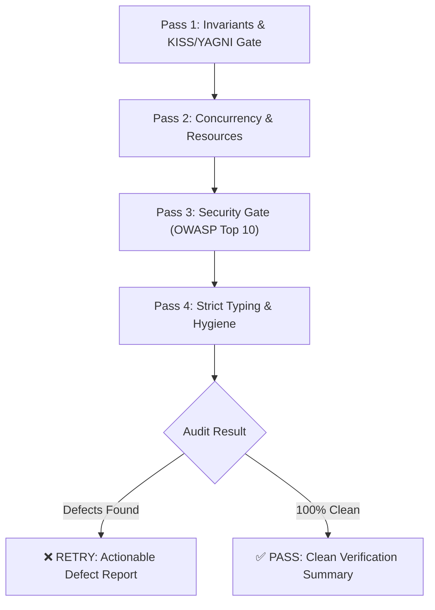

# 🛡️ Adversarial Multi-Pass Code Review (`/code-review`)

Use this skill to perform an in-depth, adversarial audit of changed code, PR diffs, or specific modules before merging or committing. Enforces strict security, bug hunting, and **Anti-Overengineering (KISS/YAGNI)**.

---

## 🔍 4-Pass Inspection Protocol



### Pass 1: Invariants, Contracts & KISS/YAGNI Gate
- **KISS/YAGNI Audit**: Did the code introduce speculative abstractions, unused parameters, micro-frameworks, or unrequested features?
- **Contract Adherence**: Are public function/class signatures backwards-compatible?
- **Edge cases**: Are boundary values (`0`, `-1`, empty collections, max size, Unicode) explicitly tested and handled?

### Pass 2: Concurrency & Resource Lifecycle
- **Race conditions**: Are shared mutable variables properly synchronized or atomic?
- **Async/Await**: Are all promises/futures awaited, and are unhandled rejections trapped?
- **Resource Cleanup**: Are file handles, database pools, sockets, and timers closed via `try...finally` / `with` / `defer`?

### Pass 3: Enterprise Security Gate (OWASP Top 10)
- **Zero Secrets**: Are API keys, passwords, or tokens hardcoded or logged?
- **Injection Defense**: Are SQL/NoSQL queries parameterized? Is command execution safe?
- **Input Sanitization**: Are user-provided strings validated and sanitized against XSS/SSRF/Prototype Pollution?

### Pass 4: Strict Typing, Hygiene & ASD-STE100 Compliance
- **Strict Types**: Are all function signatures, return types, and variables typed (no unwarranted `any`)?
- **Dead Code**: Are there leftover `console.log`, `print()`, debug breakpoints, or unused imports?
- **ASD-STE100 Compliance**: Are comments, docstrings, and diagnostic messages written in Simplified Technical English (imperative mood, concise sentences $\le 20\text{ words}$, zero colloquialisms)?

---

## 📋 Structured Output Schema

If defects are found:
```markdown
### ❌ Code Review: RETRY REQUIRED

| Severity | Category | File & Line | Finding & Defect | Actionable Surgical Fix |
| :--- | :--- | :--- | :--- | :--- |
| **High** | Concurrency | `src/cache.py:42` | Unprotected dictionary mutation across async tasks | Use `asyncio.Lock()` around dictionary access |
| **Medium** | Over-Engineering (YAGNI) | `src/service.py:12` | Speculative abstract factory with only 1 implementation | Replace with simple function/class |
```

If 100% clean:
```markdown
### ✅ Code Review: PASS
- All 4 passes verified successfully (Invariants & KISS/YAGNI, Concurrency, OWASP Top 10, Strict Typing).
- 0 vulnerabilities, 0 memory leaks, 0 over-engineered abstractions detected.
```

---

## ⚡ Pre-Flight Automated Audit (`critic_loop.py`)

Execute deterministic checks before invoking the `claude-critic` subagent:

```bash
# Run full static audit across target directory
python3 scripts/critic_loop.py --mode all --target .

# Run security and secret scan only
python3 scripts/critic_loop.py --mode security --target .

# Run syntax and bracket balance scan only
python3 scripts/critic_loop.py --mode syntax --target .
```
