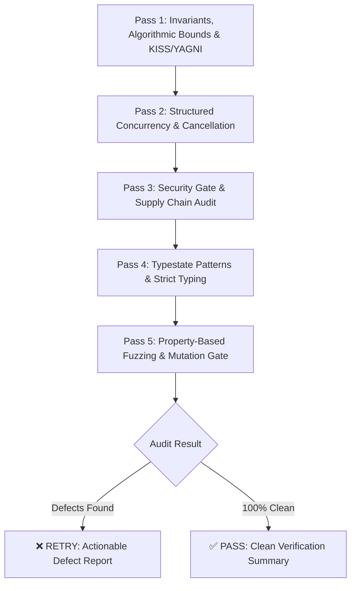

# 🛡️ Adversarial Multi-Pass Code Review (`/code-review`)

Use this skill to perform an in-depth, adversarial audit of changed code, PR diffs, or specific modules before merging or committing. Enforces strict security, bug hunting, and **Anti-Overengineering (KISS/YAGNI)**.

---

## 🔍 5-Pass Inspection Protocol



### Pass 1: Invariants, Algorithmic Bounds & KISS/YAGNI Gate
- **KISS/YAGNI Audit**: Did the code introduce speculative abstractions, unused parameters, or micro-frameworks?
- **Algorithmic Bounds**: Verify time and space complexity ($O(1)$, $O(n)$, $O(n \log n)$). Eliminate $O(n^2)$ loops and ReDoS patterns.
- **Contract Adherence**: Are public function and class signatures backwards-compatible?
- **Edge cases**: Are boundary values (`0`, `-1`, empty collections, max size, Unicode) tested and handled?

### Pass 2: Structured Concurrency, Cancellation & Resources
- **Structured Concurrency**: Are async tasks grouped using structured primitives (`TaskGroup`, `AbortController`, `errgroup`)?
- **Cancellation Propagation**: Are cancellation tokens passed through all downstream operations?
- **Async/Await Integrity**: Are all promises awaited or handled? Are floating promises eliminated?
- **Resource Cleanup**: Are file handles, database pools, sockets, and timers deterministically released?

### Pass 3: Enterprise Security Gate (OWASP Top 10) & Supply Chain
- **Zero Secrets**: Are API keys, passwords, or tokens hardcoded or logged?
- **Injection Defense**: Are SQL/NoSQL queries parameterized? Is process execution safe?
- **Input Sanitization**: Are user-provided strings sanitized against XSS, SSRF, and Prototype Pollution?
- **Supply Chain**: Are package manifests and lockfiles free of vulnerable dependencies?

### Pass 4: Typestate Patterns, Branded Types & Strict Typing
- **Typestate Invariants**: Are multi-step domain state transitions modeled using distinct types?
- **Branded Types**: Are identifiers branded to prevent primitive obsession?
- **Strict Types**: Are all function signatures, return types, and variables strictly typed (no unwarranted `any`)?
- **Zero Mutable Defaults**: Are Python functions free of mutable defaults (`def fn(x=[])`)?
- **ASD-STE100 Compliance**: Are comments written in Simplified Technical English?

### Pass 5: Property-Based Testing, Mutation Hardening & Performance Gate
- **Property-Based Testing**: Are domain invariants verified using randomized property fuzzing?
- **Mutation Hardening**: Do assertions verify logic mutations rather than line coverage alone?
- **Performance Invariants**: Are database queries free of N+1 patterns? Are hot paths benchmarked?

---

## 📋 Structured Output Schema

If defects are found:
```markdown
### ❌ Code Review: RETRY REQUIRED

| Severity | Category | File & Line | Finding & Defect | Actionable Surgical Fix |
| :--- | :--- | :--- | :--- | :--- |
| **High** | Concurrency | `src/cache.py:42` | Unprotected dictionary mutation across async tasks | Use `asyncio.Lock()` around dictionary access |
| **Medium** | Over-Engineering (YAGNI) | `src/service.py:12` | Speculative abstract factory with only 1 implementation | Replace with simple function/class |
```

If 100% clean:
```markdown
### ✅ Code Review: PASS
- All 4 passes verified successfully (Invariants & KISS/YAGNI, Concurrency, OWASP Top 10, Strict Typing).
- 0 vulnerabilities, 0 memory leaks, 0 over-engineered abstractions detected.
```

---

## ⚡ Pre-Flight Automated Audit (`critic_loop.py`)

Execute deterministic checks before invoking the `claude-critic` subagent:

```bash
# Run full static audit across target directory
python3 scripts/critic_loop.py --mode all --target .

# Run security and secret scan only
python3 scripts/critic_loop.py --mode security --target .

# Run syntax and bracket balance scan only
python3 scripts/critic_loop.py --mode syntax --target .
```

---

## 📚 Pattern Catalog Reference

For concrete implementation patterns across TypeScript, Python, Rust, and Go, refer to:
- [patterns.md](references/patterns.md)
