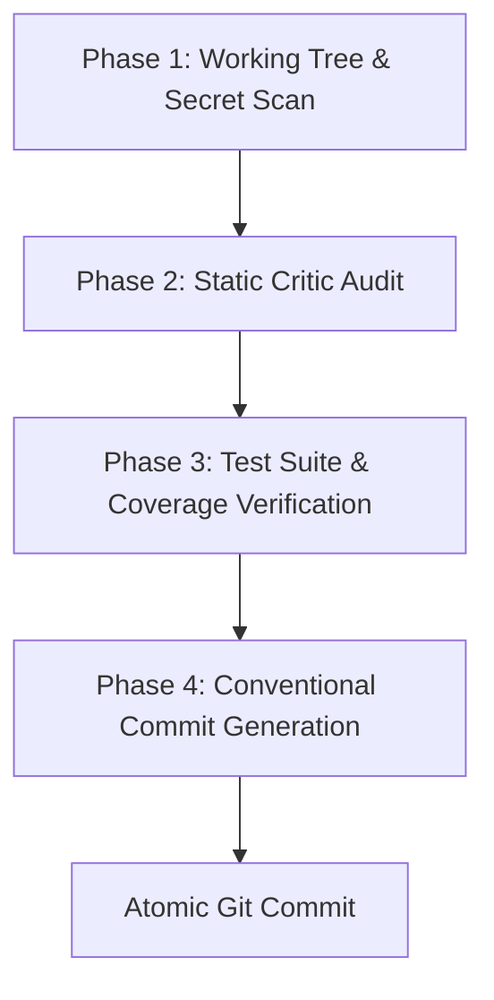

# 🚀 Pre-Commit Verification Pipeline (`/commit`)

Use this skill to inspect, verify, and commit code changes atomically. Guarantees zero secret leaks, 100% test pass rate, and Conventional Commits formatting under the ASD-STE100 standard.

---

## 📋 4-Phase Pre-Commit Protocol



### Phase 1: Working Tree & Secret Inspection
1. Inspect modified and staged files:
   ```bash
   git status --short
   git diff --staged
   ```
2. Check for staged credentials or unencrypted secrets using `critic_loop.py`:
   ```bash
   python3 scripts/critic_loop.py --mode security --target .
   ```
3. Abort immediately if any private key, cloud token, or unauthorized file is staged.

### Phase 2: Static Critic Audit & Public API Contract Guard
Run the automated AST, semantic critic, and public API drift guard across changed files:
```bash
python3 scripts/critic_loop.py --mode all --target .
python3 scripts/api_contract_guard.py --target .
```
Verify:
- 0 breaking changes to exported signatures without backwards-compatible defaults.
- 0 unhandled panics or unwraps in production code.
- 0 command injection or dangerous eval/exec calls.
- 0 unhandled syntax errors.

### Phase 3: Test Suite Verification
Run the project test suite using `auto_debug_runner.py`:
```bash
python3 scripts/auto_debug_runner.py --run-tests
```
- If tests fail, invoke auto-debug loop to heal code surgically.
- Do NOT proceed to commit if any test fails.

### Phase 4: Conventional Commit Formatting
Structure commit messages following Conventional Commits and ASD-STE100 rules:

```
<type>(<scope>): <imperative summary under 50 characters>

<body explaining problem and surgical solution under 72 chars per line>

- Verification: tests passing, static audit green.
```

#### Approved Types:
- `feat`: New user-facing capability or API addition.
- `fix`: Surgical bug fix or defect resolution.
- `refactor`: Code modification without behavior or API changes.
- `perf`: Measurable performance improvement.
- `test`: Addition or refactoring of test suites.
- `docs`: Documentation, README, or comment modifications.
- `chore`: Tooling, build system, or dependencies maintenance.

#### ASD-STE100 Commit Rules:
- Write header in imperative mood ("Add JWT validation", not "Added JWT validation").
- Do not add period at end of header line.
- Maximum 50 characters in header line.
