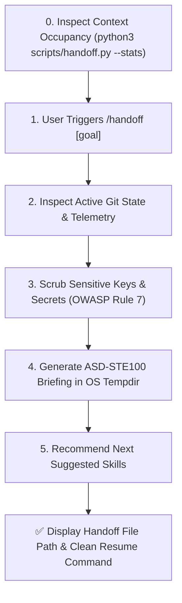

# 📋 Session Handoff Pipeline (`/handoff`)

Use this skill when completing an agent session, hitting context boundaries, or transferring execution to a fresh agent, another model, or a parallel worktree. It generates a portable, zero-fluff Markdown handoff document in the operating system temporary directory (`$TMPDIR`) without polluting the workspace git repository.

---

## 🚀 Operational Workflow



---

### Step 0: Inspect Context Occupancy (Pre-Flight)
Check current token telemetry and context window utilization before ending a session:
```bash
python3 scripts/handoff.py --stats
# or via auto debug runner:
python3 scripts/auto_debug_runner.py --context
```
| Occupancy Band | Token Range | Status | Action Required |
| :--- | :--- | :--- | :--- |
| **Healthy** | $< 50,000$ tokens | `HEALTHY` | Continue normal iteration in active session. |
| **Moderate** | $50,000 - 80,000$ tokens | `MODERATE` | Hand off at next completed milestone. |
| **Critical** | $\ge 80,000$ tokens | `CRITICAL` | Execute `/handoff` immediately to prevent context truncation. |

---

### Step 1: Parse Input & Target Objective
- Capture the optional goal or focus provided by the user (e.g. `/handoff complete the payment retry logic`).
- If no argument is provided, synthesize the immediate next milestone from the active plan or task list.

### Step 2: Deterministic Telemetry & Context Extraction
Execute the deterministic handoff runner:
```bash
python3 scripts/handoff.py "<target-goal>" --summary "<implementation-notes>"
```
Or via the auto debug runner:
```bash
python3 scripts/auto_debug_runner.py --handoff "<target-goal>"
```

The script autonomously:
1. Queries current Git branch, modified files, and last commit hash.
2. Injects the last recorded test run status (`PASS` / `FAIL`).
3. Injects the last recorded critic loop audit status.
4. Redacts all API keys, access tokens, and private keys.
5. Emits a clean Markdown document into `tempfile.gettempdir()`.

### Step 3: ASD-STE100 Handoff Document Structure
The created briefing document adheres to strict engineering invariants:
- **Portability**: Stored in the system temporary directory (`/tmp` or `%TEMP%`).
- **No Token Duplication**: Links to files and ADRs by path (`file:///...`), never copy-pasting entire code blocks.
- **Architectural Constraints**: Explicitly lists KISS, YAGNI, and invariant requirements.
- **Dead-Ends**: Documents failed approaches so the subsequent agent does not repeat them.
- **Suggested Skills**: Specifies exact slash commands for the incoming session:
  - `/opus-dev`: For end-to-end TDD and closed-loop verification.
  - `/plan`: For milestone decomposition.
  - `/auto-debug`: When test failures require autonomous resolution.
  - `/code-review`: When static hygiene or security violations require inspection.
  - `/commit`: When changes are verified green and ready for atomic conventional commit.

### Step 4: Present Output to User
Output the absolute path to the generated handoff file and summarize the recommended starting command for the next session.

---

### Step 5: Resume Execution in New Agent Session
1. Close or reset the conversation.
2. In the fresh session (100% clean context), prompt:
   `Leggi il briefing di handoff ed esegui i task: <path-to-handoff-file>`
3. The incoming agent resumes work immediately with zero historical context bloat.
