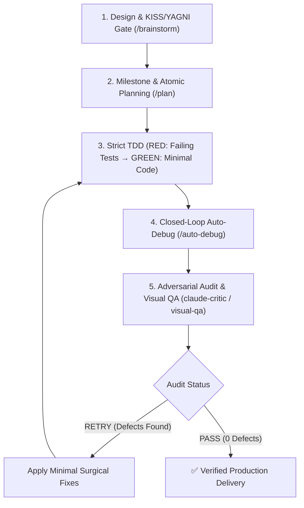

# 🚀 Claude Opus 5.5 Unified Engineering Meta-Engine (`/opus-dev`)

> **Paths**: `scripts/` is the suite folder, not your project: `~/.gemini/config/plugins/antigravity-dev-suite/scripts/`. On Windows use `py -3` instead of `python3`. The Stop gate runs the checks again when you finish.

Use this skill when developing a feature, bug fix, refactor, or complete module under the full **Claude Opus 5.5 Standard**. It autonomously executes a self-healing engineering loop with strict **KISS & YAGNI enforcement**, running adversarial reviews and surgical fixes in a closed loop until achieving a clean `PASS` verdict.

---

## 📋 Autonomous Closed-Loop Engineering Pipeline

---

### Phase 1: Rapid Design & Algorithmic Bounds Gate (Inspired by `/brainstorm`)
- **Repository Context Map**: Generate high-density symbol map using `python3 ~/.gemini/config/plugins/antigravity-dev-suite/scripts/repo_map.py . --max-tokens 2048` to establish context topology.
- **Cross-File Symbol Impact & Call-Graph**: Run `python3 ~/.gemini/config/plugins/antigravity-dev-suite/scripts/symbol_impact.py <symbol>` to trace all definitions, callers, and references across the workspace before modifying signatures.
- **Semantic Symbol Slicing**: Use `python3 ~/.gemini/config/plugins/antigravity-dev-suite/scripts/semantic_slice.py <file> --symbol <name>` to extract targeted functions and classes without loading full files.
- **Formal Invariant Matrix**: Tabulate pre-conditions, post-conditions, and invariants before code writing.
- **Zero Filler (ASD-STE100)**: Start immediately with structured technical analysis.
- **KISS & YAGNI Check**: Choose the simplest design with the minimum number of moving parts. Avoid speculative abstractions.
- **Algorithmic Bounds**: Bound time and space complexity ($O(1)$, $O(n)$, $O(n \log n)$). Eliminate $O(n^2)$ loops and ReDoS patterns.
- **Negative Constraints Matrix**: Verify public API stability and forbidden patterns.
- **ADR Persistence**: For significant architectural choices, record an Architecture Decision Record under `docs/adr/`.

### Phase 2: Atomic Plan & Test Targets (Inspired by `/plan`)
- **Topological Subtask Ordering**: Sequence subtasks across tiers (Contracts/Types $\to$ Tests RED $\to$ Domain GREEN $\to$ Integration).
- Break the task into atomic, verifiable subtasks (1-2 files per step).
- For each subtask, specify:
  - Exact file paths to create or edit.
  - The failing test to write first (RED), including boundary and property-based targets.
  - The minimal implementation to satisfy the test (GREEN), applying Typestate patterns and Branded Types.

### Phase 3: Defensive TDD & Property-Based Execution
- **RED**: Write and execute unit and property-based tests proving requirements, invariants, and edge cases (`0`, `-1`, `null`, empty collections, timeouts).
- **GREEN**: Implement minimal, highly typed production code:
  - Enforce strict typing, Branded Types for identifiers, and Typestate patterns for domain lifecycles.
  - Implement Structured Concurrency with cancellation token propagation and bound worker pools.
  - Handle resource lifecycles (`try...finally`, `with`, `defer`).
  - Eliminate mutable default arguments (`def fn(x=[])`).
  - Execute property-based fuzzing tests (`python3 ~/.gemini/config/plugins/antigravity-dev-suite/scripts/auto_debug_runner.py --fuzz`).
  - Verify mutation resistance on modified files: `python3 ~/.gemini/config/plugins/antigravity-dev-suite/scripts/auto_debug_runner.py --mutation --diff`.

### Phase 4: Autonomous Closed-Loop Auto-Debug, Typecheck & Race Gate (`/auto-debug`, `/benchmark`)
- Execute test runner autonomously (`python3 ~/.gemini/config/plugins/antigravity-dev-suite/scripts/auto_debug_runner.py --run-tests`).
- Execute static typecheck (`python3 ~/.gemini/config/plugins/antigravity-dev-suite/scripts/auto_debug_runner.py --typecheck`).
- Execute concurrency race detector (`python3 ~/.gemini/config/plugins/antigravity-dev-suite/scripts/auto_debug_runner.py --race`).
- Detect non-deterministic test races: `python3 ~/.gemini/config/plugins/antigravity-dev-suite/scripts/auto_debug_runner.py --detect-flaky`.
- Validate database migrations against Rule 14 zero-downtime expand/contract requirements.
- Use context window token hygiene: condense voluminous passing test output and isolate AST failure traces.
- If performance regressions occur, run benchmark runner (`python3 ~/.gemini/config/plugins/antigravity-dev-suite/scripts/auto_debug_runner.py --benchmark`).

### Phase 5: Adversarial Audit & Self-Healing Loop (`claude-critic`, `visual-qa`)
- **Tier-1 Deterministic Fast-Path Audit**:
  - Pre-flight static audit: Execute `python3 ~/.gemini/config/plugins/antigravity-dev-suite/scripts/critic_loop.py --mode all --target .` to catch syntax faults, bracket imbalances, quadratic traps, exposed secrets, unreleased mutexes, and dangerous migration patterns in sub-second time.
  - AST diff hygiene & comment preservation: Execute `python3 ~/.gemini/config/plugins/antigravity-dev-suite/scripts/diff_guard.py` to ensure zero comment stripping and no KISS complexity blowups against HEAD.
  - Public API contract drift gate: Execute `python3 ~/.gemini/config/plugins/antigravity-dev-suite/scripts/api_contract_guard.py --target .` to ensure zero breaking changes in exported signatures.
  - If Tier-1 fails, apply minimal surgical fixes immediately without spending roundtrips on LLM subagents.
- **Tier-2 Adversarial Cognitive Audit**: When necessary, invoke `claude-critic` (always configured with `model: inherit`, never `model: pro` to prevent latency bottlenecks) across the 7 Opus pillars.
- **Frontend / UI & Accessibility**: If HTML, CSS, React, Vue, or Svelte was modified, run `/visual-qa` with dual-viewport (1280x800 Desktop + 375x667 Mobile) and automated WCAG 2.1 AA accessibility checks reviewed via `visual-qa-critic`. The Stop gate enforces this step: start the dev server, open the screenshots it lists and look at them.
- **Closed-Loop Resolution**:
  - Run the full gate: `python3 ~/.gemini/config/plugins/antigravity-dev-suite/scripts/agy_hook.py check`.
  - If it reports `RESULT: FAIL`, fix each listed problem at its root cause and run it again.
  - **Repeat until the gate prints `RESULT: PASS`.** The Stop hook runs the same gate and blocks completion while it fails.
  - Never delete, skip or loosen a test, and never silence a finding with `# nosec`, to get a PASS.
- **Delivery**: Paste the real final gate output (`RESULT: PASS` and the checks run). A claim without output is not evidence.
- **Session Transfer & Handoff**: If context budget is reached or session concludes, run `/handoff` to serialize the briefing and telemetry for the subsequent session.
