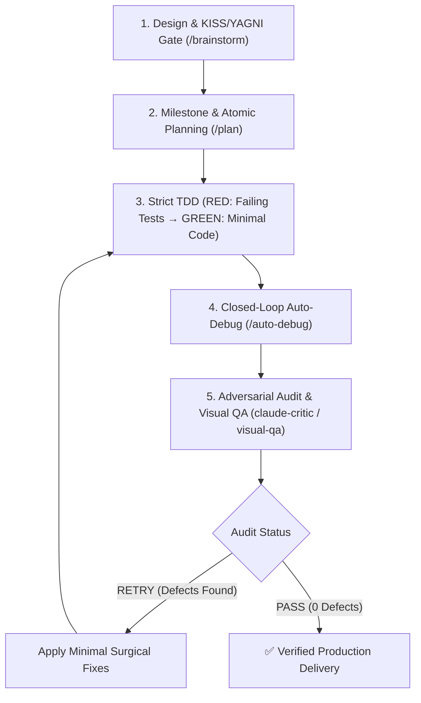

# 🚀 Claude Opus 5.5 Unified Engineering Meta-Engine (`/opus-dev`)

Use this skill when developing a feature, bug fix, refactor, or complete module under the full **Claude Opus 5.5 Standard**. It autonomously executes a self-healing engineering loop with strict **KISS & YAGNI enforcement**, running adversarial reviews and surgical fixes in a closed loop until achieving a clean `PASS` verdict.

---

## 📋 Autonomous Closed-Loop Engineering Pipeline

---

### Phase 1: Rapid Design & KISS/YAGNI Gate (Inspired by `/brainstorm`)
- **Zero Filler (ASD-STE100)**: Start immediately with structured technical analysis.
- **KISS & YAGNI Check**: Choose the simplest design with the minimum number of moving parts. Avoid speculative abstractions or forward-looking configuration bloat.
- **Negative Constraints Matrix**: Verify public API stability and forbidden patterns.

### Phase 2: Atomic Plan & Test Targets (Inspired by `/plan`)
- Break the task into atomic, verifiable subtasks (1-2 files per step).
- For each subtask, specify:
  - Exact file paths to create/edit.
  - The failing test to write first (RED).
  - The minimal implementation to satisfy the test (GREEN).

### Phase 3: Defensive TDD Execution (KISS & Minimal)
- **RED**: Write and execute unit/integration tests proving requirements and boundary conditions (`0`, `-1`, `null`, empty collections, concurrency, timeouts).
- **GREEN**: Implement minimal, highly typed production code:
  - Enforce strict typing (TypeScript `strict`, Python Pydantic/typing, Rust Result/Option, Go error checks).
  - Handle resource lifecycles (`try...finally`, `with`, `defer`).
  - No premature optimization or extra features beyond what tests require.

### Phase 4: Autonomous Closed-Loop Auto-Debug (`/auto-debug`)
- Execute the test suite in terminal (`npm test`, `pytest`, `cargo test`, `go test`).
- If any test or typecheck fails:
  - Analyze the stacktrace at the AST and semantic level.
  - Apply minimal targeted surgical fix.
  - Re-verify in a closed loop (up to 3 autonomous cycles) until 100% green.

### Phase 5: Adversarial Audit & Self-Healing Loop (`claude-critic`, `visual-qa`)
- **Adversarial Audit**: Invoke `claude-critic` across the 7 Opus pillars (Invariants & KISS/YAGNI, Concurrency, OWASP Top 10, Type Safety, Boundary Conditions).
- **Frontend / UI**: If HTML, CSS, React, Vue, or Svelte was modified, run `/visual-qa` with dual-viewport (1280x800 Desktop + 375x667 Mobile) and review via `visual-qa-critic`.
- **Closed-Loop Resolution**:
  - If the critic returns `RETRY`, parse all reported violations and suggested fixes.
  - Apply minimal surgical fixes to codebase and test suite.
  - Re-run test suite and re-audit via `claude-critic`.
  - **Repeat the loop until the critic returns status `PASS` with 0 violations.**
- **Delivery**: Present conclusive terminal verification evidence and final clean critic verdict in ASD-STE100 format.
