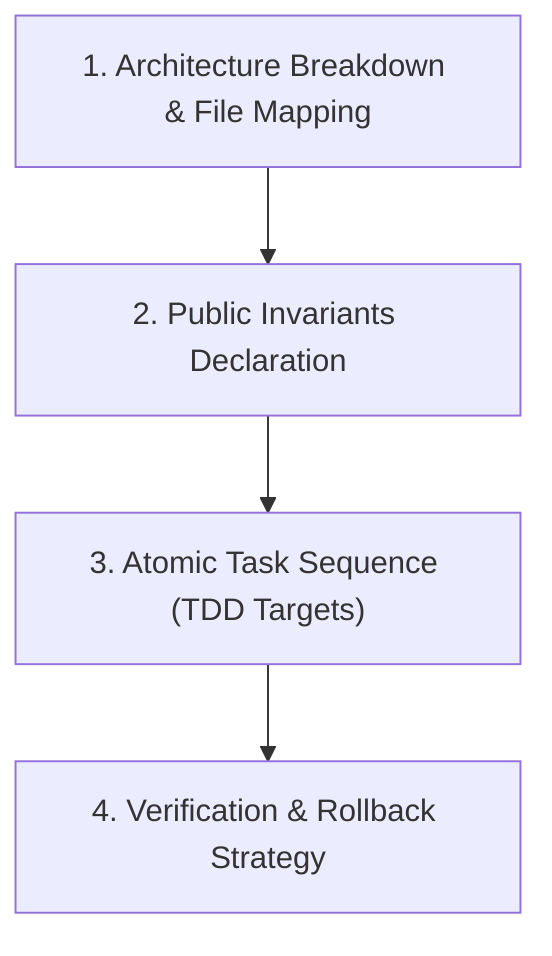

# 🗺️ Engineering Plan & Milestone Decomposition (`/plan`)

Use this skill to break down complex tasks, multi-file refactors, or new feature additions into atomic, verifiable subtasks before execution.

---

## 📋 Planning Protocol

### 1. File & Dependency Mapping
Extract the codebase symbol topology using `python3 scripts/repo_map.py . --max-tokens 2048`.
List the exact files to create or modify:
- **Created**: e.g., `src/auth/jwt_provider.py`, `tests/test_jwt_provider.py`
- **Modified**: e.g., `src/config.py`, `src/routes/api.py`

### 2. Invariants, Algorithmic Bounds & Negative Constraints
- Explicitly declare public contracts, database models, or external interfaces that **must remain unbroken**.
- Define algorithmic bounds ($O(1)$, $O(n)$, $O(n \log n)$). Identify and eliminate quadratic or ReDoS risks.
- Define domain Typestate transitions and Branded Type definitions.
- **Formal Inductive Invariant Specification**:
  When specifying iterative algorithms or state machines, define:
  1. **Precondition ($P$)**: Initial state predicate required before entry.
  2. **Loop Invariant ($I$)**: Inductive assertion holding true before and after each iteration ($I \land B \implies I'$).
  3. **Loop Variant ($V$)**: Strictly monotonically decreasing non-negative metric ($V \ge 0$) proving termination.
  4. **Postcondition ($Q$)**: Guaranteed final state verified upon termination ($I \land \neg B \implies Q$).

### 3. Atomic Task Breakdown (Red-Green Sequence)
Format each subtask as an atomic, verifiable unit:

#### Task 1: [Domain Model, Typestate & Property Tests]
- **Target Files**: `src/models/user.py`
- **Test Target (RED)**: Write failing property-based test in `tests/test_user.py` asserting validation invariants.
- **Production Code (GREEN)**: Implement model with Branded Types and Typestate transitions.
- **Verification Command**: `pytest tests/test_user.py -v`

#### Task 2: [Service Layer Logic]
- **Target Files**: `src/services/auth_service.py`
- **Test Target (RED)**: Add unit test asserting token generation and expiration edge cases.
- **Production Code (GREEN)**: Implement business logic with defensive error handling.
- **Verification Command**: `pytest tests/test_auth_service.py -v`

#### Task 3: [API Route Integration]
- **Target Files**: `src/routes/auth_routes.py`
- **Test Target (RED)**: Add HTTP integration test validating status codes `200`, `401`, `422`.
- **Production Code (GREEN)**: Wire endpoint into router.
- **Verification Command**: `pytest tests/ -v`

### 4. Verification Gate
- Final full-suite verification command (`npm test`, `pytest`, `cargo test`, `go test`).
- Plan review checklist before triggering execution via `/opus-dev`.
