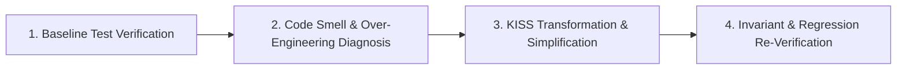

# 🧹 Safe Refactoring & KISS Simplification (`/refactor`)

Use this skill to simplify code, eliminate over-engineering, remove duplication, improve performance, or modularize architecture without altering external behavior.

---

## 📋 4-Step Safe Refactoring Protocol

### Step 1: Baseline Verification (Pre-Refactor Check)
1. Run the test suite (`npm test`, `pytest`, `cargo test`, `go test`).
2. **Rule**: If any existing test fails, stop and fix it first. Never refactor on top of broken baseline tests.

### Step 2: Over-Engineering & Smell Diagnosis
Identify the exact refactoring targets:
- **Speculative Complexity (YAGNI)**: Flatten unneeded abstract layers, redundant wrappers, or unused generic interfaces.
- **Duplicated Logic (DRY)**: Extract genuine duplicated logic (Rule of Three).
- **High Cyclomatic Complexity**: Decompose large conditional trees into strategy lookups or simple guard clauses.
- **Tight Coupling**: Introduce clean dependency injection or protocol interfaces.

### Step 3: KISS Transformation
- Apply edits incrementally (one module or file at a time).
- Prefer simpler standard library constructs over heavy helper classes.
- Preserve all existing public signatures, return types, and argument names unless explicitly requested.
- Remove dead code, obsolete comments, and unused imports.

### Step 4: Regression Re-Verification
- Run the full test suite and typechecker.
- Confirm:
  - 100% of existing tests pass.
  - Zero breaking changes to public APIs.
  - Substantially simpler, cleaner, and more maintainable code structure.
