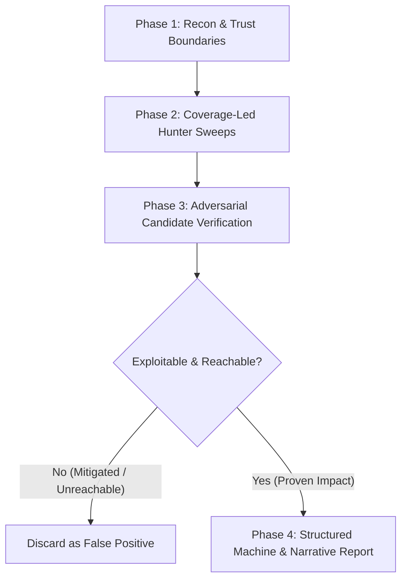

# 🛡️ Systematic Security Audit & Vulnerability Harness (`/security-audit`)

Use this skill to conduct deep, systematic vulnerability assessments across codebases, APIs, microservices, and agent configurations. Inspired by Cloudflare's security audit harness and calibrated under the **Claude Opus 5.5 + ASD-STE100** standard, this workflow eliminates theoretical noise by enforcing adversarial verification before confirming any finding.

---

## 🎯 Operating Modes

1. **Guidance Mode**: Fast architectural threat modeling, single-file vulnerability review, or cryptographic consultation.
2. **Full Audit Mode**: Comprehensive 4-phase vulnerability discovery pipeline producing structured reports and findings ledgers.

---

## 🔄 4-Phase Vulnerability Hunting Pipeline



---

### Phase 1: Reconnaissance & Trust Boundary Mapping

Identify and document all entry points, trust transitions, and sinks:

1. **Input Surfaces**:
   - HTTP routes, WebSocket handlers, gRPC endpoints, and message queues.
   - CLI flags, environment variables, configuration files, and IPC channels.
2. **Trust Transitions**:
   - Authentication gates, tenant isolation barriers, and privilege boundaries.
   - Network egress points (SSRF vectors, webhooks, third-party API clients).
3. **Data Sinks**:
   - Database queries (SQL/NoSQL/ORM), shell execution, and filesystem operations.
   - Deserialization sinks, reflection calls, and dynamic memory allocations.
4. **Supply Chain & Dependency Auditing** (`references/supply-chain.md`):
   - Dependency vulnerability scanning: `pip-audit`, `npm audit`, `cargo audit`, `govulncheck`.
   - Lockfile integrity: unpinned dependencies, malicious package replacements, and registry confusion.

---

### Phase 2: Coverage-Led Hunter Sweeps

Audit components systematically against specialized attack classes:

1. **Web Protocols & Authentication** (`references/web-and-auth.md`):
   - Broken Object Level Authorization (BOLA / IDOR).
   - Server-Side Request Forgery (SSRF) and DNS rebinding.
   - Authentication bypasses, token validation flaws, and session fixation.
   - HTTP request smuggling, header splitting, and caching deception.
2. **AI, LLM & Agentic Tool Execution** (`references/ai-and-llm.md`):
   - Prompt injection and system instruction overrides.
   - Unsafe tool execution and arbitrary command injection via LLM arguments.
   - Context poisoning and sensitive data extraction via retrieval pipelines.
   - Subagent credential leakage and unauthorized privilege delegation.
3. **Memory Safety & Injection** (`references/memory-and-injection.md`):
   - Parameterized query bypasses and second-order injections.
   - Unsafe deserialization and prototype pollution.
   - Path traversal and arbitrary file write/overwrite.
   - Buffer overflows, integer wraps, and use-after-free (C/C++/Rust unsafe blocks).
4. **Supply Chain & Third-Party Integrity** (`references/supply-chain.md`):
   - Transitive dependency vulnerabilities with reachable exploitation paths.
   - Unpinned dependencies and dependency confusion attacks.
   - Lifecycle install scripts (`postinstall`, `build.rs`) executing arbitrary shell commands.

---

### Phase 3: Adversarial Candidate Verification (Hunter vs. Verifier)

Never report an unverified or purely theoretical vulnerability. For every candidate finding, act as an adversarial verifier attempting to **disprove** the vulnerability:

1. **Source-to-Sink Taint Trace**:
   - Does untrusted user input directly reach the vulnerable sink without validation?
   - Do framework-level type validators, sanitizers, or ORMs neutralize the payload?
2. **Reachability Analysis**:
   - Can an external unauthenticated attacker access this code path?
   - Are intermediate authorization gates or middleware checks active?
3. **Falsification Gate**:
   - If the candidate cannot be exploited under production constraints, reject it immediately.
   - Document the neutralizing defense in the coverage ledger.

---

### Phase 4: Structured Output & Reporting

Generate two standardized audit artifacts:

#### 1. Machine-Readable Ledger (`findings.json`)
```json
{
  "audit_version": "1.0",
  "target": "src/api",
  "findings": [
    {
      "id": "SEC-001",
      "severity": "HIGH",
      "title": "BOLA / IDOR in Account Retrieval Route",
      "cwe": "CWE-639",
      "file": "src/controllers/account.py",
      "line": 42,
      "source_to_sink": "GET /accounts/:id -> account_id passed directly to db.find() without tenant scope",
      "impact": "Authenticated user can access arbitrary tenant account records",
      "remediation": "Add tenant_id filter to database query from validated session context"
    }
  ]
}
```

#### 2. Narrative Security Summary (`SECURITY-REPORT.md`)

| ID | Severity | Category | File & Line | Verified Vulnerability | Actionable Remediation |
| :--- | :--- | :--- | :--- | :--- | :--- |
| **SEC-001** | High | Auth / BOLA | `src/controllers/account.py:42` | Missing tenant isolation in account retrieval | Enforce `tenant_id` session filter |
